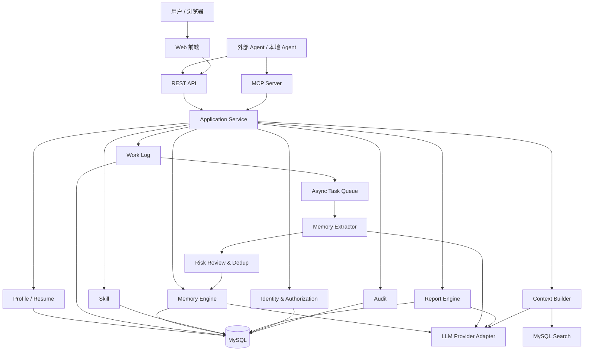
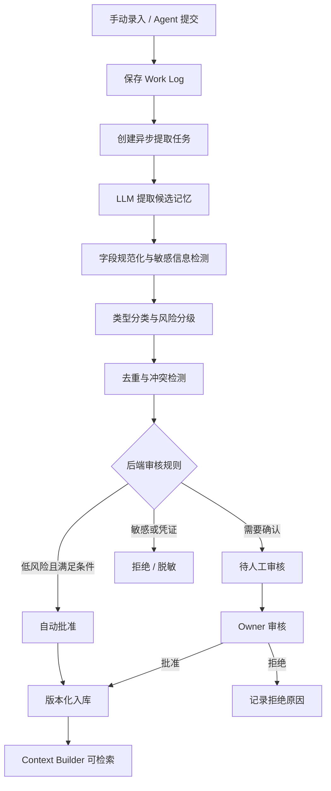

# Personal Work Twin（个人工作记忆与进化系统）
## 完整技术设计文档 v1.1（MySQL 版）

- 文档版本：v1.1
- 编写日期：2026-11-13
- 产品形态：个人工作记忆平台 + MCP Server + REST API
- 技术路线：Spring Boot 3.x、MyBatis-Plus、MySQL 8.0+、Flyway
- 架构策略：模块化单体，预留多用户，MVP 不引入复杂多租户体系
- 数据库基线：MySQL 8.0.32+（全文检索依赖 InnoDB `ngram` 解析器，多值索引依赖 8.0.17+）

> v1.1 变更说明：数据库从 PostgreSQL 迁移到 MySQL，产品目标、领域模型、审核机制、MCP/REST 契约不变。
> 变更范围限于存储与检索实现、任务领取 SQL、行级安全补偿措施与备份恢复方案，详见第 24 章。

---

# 1. 文档目的与范围

本文档定义 Personal Work Twin（以下简称 PWT）的产品目标、系统边界、总体架构、领域模型、数据库设计、记忆审核机制、Agent 接入方式、MCP 工具与资源、REST API、权限模型、安全策略、页面规划、部署方案、开发里程碑和验收标准。本文档为 MySQL 基线版本。

本文档面向产品设计、系统架构、后端开发、前端开发、测试和后续 Agent/Codex 实施使用。文档中的数据库 DDL 和接口定义作为 MVP 的基线设计；具体实现时可根据项目现有工程规范微调，但不得破坏核心安全和数据隔离约束。

## 1.1 产品愿景

PWT 是一个由个人长期拥有和控制的工作记忆系统。它不仅是个人主页或简历网站，也不是简单的聊天记录存储，而是把个人的工作事实、项目经历、技术决策、工作偏好、约束、技能和目标整理为可持续维护的结构化知识。

系统同时服务两类使用者：

1. 人：通过网站查看、编辑个人资料、工作记录、长期记忆、Skill、决策和报告。
2. Agent：通过 MCP 和 REST API，在获得授权后读取适用的个人上下文、提交工作记录、提出记忆候选、调用 Skill 和生成报告。

核心目标是让不同设备、不同模型、不同 Agent 在授权范围内共享同一份可信的个人工作上下文，减少重复解释，并让记忆随着真实工作逐步积累和修正。

## 1.2 MVP 必须实现的能力

- 个人资料和简历：支持在线维护、版本留存、固定公开链接和结构化 JSON。
- 工作记录：支持手动录入和 Agent 提交，保留来源、项目、时间和原始内容。
- 长期记忆：从工作记录中提取候选记忆，经过分级审核后成为可供 Agent 使用的正式记忆。
- 工作风格：沉淀沟通偏好、编码习惯、文档风格等规则。
- Skill 库：保存可被 Agent 调用或注入上下文的 Markdown Skill。
- Context Builder：根据当前任务检索、过滤和排序记忆，生成有 Token 预算的上下文包。
- MCP Server：以标准化资源和工具形式服务 Agent。
- REST API：服务网站、后台管理、审核、分页、导出和集成。
- 审计与授权：记录 Agent 和用户的关键操作，支持凭证撤销和 scope 限制。
- 周报和学习建议：从工作记录、项目、阻塞项和记忆中生成可追溯的结果。

## 1.3 明确不做的事情

- 不承诺精准预测行业、职业或技术趋势。趋势模块只呈现信号、证据、假设和不同发展分支。
- 不把原始聊天记录全部无差别保存为长期记忆。
- 不允许 Agent 直接把任意内容标记为已批准记忆。
- 不向匿名访问者开放私密工作记录、记忆、Skill、约束和决策。
- MVP 不建设独立向量数据库，不拆成微服务，不做复杂组织级租户管理。
- 不把 PWT 设计成新的通用身份认证平台；MVP 先实现受限 Agent 凭证和用户身份校验，后续再评估完整 OAuth Authorization Server。

---

# 2. 关键产品决策

| 决策项 | 选定方案 | 说明 |
|---|---|---|
| 记忆写入 | 分级自动审核 | 低风险事实可自动批准；推断、敏感和冲突内容进入人工审核或拒绝 |
| 数据存储 | MySQL 8.0+ | 结构化数据、JSON、事务与审计统一存储；全文检索先由 InnoDB FTS 兜底，语义检索按效果外挂 |
| Agent 接入 | MCP + REST API | MCP 面向 Agent 工作流；REST 面向网站和管理端 |
| 记忆采集来源 | Agent + 手动 | 两类来源都保留 source metadata 和审计 |
| 产品定位 | 预留多用户 | 业务数据统一带 user_id；预留 tenant_id，不在 MVP 引入复杂租户流程 |
| 系统架构 | 模块化单体 | 先降低部署和事务复杂度，领域边界清晰后再考虑拆分 |
| LLM 策略 | Provider 抽象 | 不绑定单一模型供应商，模型输出必须经过后端规则校验 |
| 检索策略 | MySQL 结构化过滤 + 应用层加权评分 | MVP 以结构化条件与全文检索候选集为主，先验证数据价值，后续按效果外挂向量检索 |
| Skill 存储 | Markdown + 元数据 | 便于人编辑、版本管理和 Agent 消费 |
| 异步任务 | MySQL 任务表 | MVP 避免引入消息中间件；后续可替换为 MQ |

---

# 3. 用户角色与使用场景

## 3.1 用户角色

- **Owner（数据所有者）**：维护自己的资料、记忆、Skill、工作记录和授权。
- **Agent Client（接入 Agent）**：经过注册和授权的模型客户端、自动化 Agent 或本地工具。
- **Administrator（平台管理员）**：负责平台运行、账号管理和安全审计；默认不应随意读取用户私密内容。
- **Anonymous（匿名访问者）**：仅可读取用户明确公开的个人主页和公开简历。

## 3.2 核心场景

### 场景 A：Agent 记录一次工作

1. 用户让 Agent 完成一个开发任务。
2. Agent 调用 `capture_work_log` 提交标题、项目、工作摘要、过程和结果。
3. 服务端校验 Agent 身份、scope、用户归属、字段长度和幂等键。
4. 工作记录落库，并创建异步记忆提取任务。
5. 提取器生成候选记忆，分类、去重、冲突检测和风险评估。
6. 低风险候选按策略自动批准，其余进入待审核队列。
7. 用户在网站查看记录和审核结果。

### 场景 B：Agent 执行任务前获取上下文

1. Agent 调用 `build_context`，提交任务描述、项目和 Token 预算。
2. 系统根据已验证身份确定 user_id，不接受调用方传入的 user_id 覆盖。
3. 只检索授权范围内、状态为 approved 且未过期的记忆。
4. 按任务相关性、重要性、可信度、时效性和项目匹配度排序。
5. 将适用约束、风格规则、Skill 和相关记忆组装成 Context Packet。
6. 返回上下文内容和来源引用，便于 Agent 使用和追溯。

### 场景 C：用户手动修正一条记忆

1. 用户打开记忆详情，查看记忆内容和来源证据。
2. 用户修改内容或选择拒绝、归档、替代旧记忆。
3. 系统保留历史版本和审核记录，不直接覆盖审计历史。
4. 后续 Context Builder 只使用当前有效版本。

### 场景 D：每周生成工作周报

1. 用户或 Agent 请求指定周区间。
2. 系统检索该时间段工作记录、项目进展、决策和阻塞项。
3. LLM 生成结构化周报。
4. 周报保存输入来源、生成模型、提示词版本和生成时间。
5. 用户可编辑、确认和导出周报。

---

# 4. 总体系统架构

## 4.1 架构原则

- **单一事实源**：网站、REST API 和 MCP Server 读写同一业务服务和 MySQL 数据源。
- **业务逻辑复用**：MCP Handler 和 REST Controller 只做协议适配，不复制领域逻辑。
- **权限后置于服务端**：任何资源读取和工具执行都必须在服务端完成身份、scope、user_id 和 visibility 校验。
- **LLM 不拥有最终决策权**：LLM 负责提取、分类建议、摘要和生成；状态迁移、权限和风险规则由后端控制。
- **证据可追溯**：每条正式记忆尽可能关联工作记录或人工来源。
- **先简单后演进**：MVP 采用模块化单体、MySQL 和任务表；性能瓶颈出现后再拆分。

## 4.2 逻辑架构



## 4.3 部署视图

MVP 建议部署为一个 Spring Boot 应用，内含 REST 和 MCP 两个入口；前端可独立部署，也可由反向代理托管静态资源。

```text
Internet / LAN
    |
Reverse Proxy (Nginx / Caddy)
    |--------------------|
    |                    |
Web UI              Spring Boot App
                         |-- REST API
                         |-- MCP Streamable HTTP
                         |-- Async Task Worker
                         |-- Scheduler
                              |
                         MySQL 8.0+ (InnoDB)
                              |
                          LLM Provider
```

## 4.4 推荐技术栈

| 层次 | 推荐技术 | 说明 |
|---|---|---|
| 后端 | Java 17+、Spring Boot 3.2.x | 与现有技术栈保持兼容 |
| ORM | MyBatis-Plus | 复杂检索可使用 XML 或自定义 SQL |
| 数据库 | MySQL 8.0.32+（InnoDB） | JSON、事务、全文检索；utf8mb4；行级安全由业务层实现 |
| 数据迁移 | Flyway | 所有 DDL 版本化 |
| MCP | 官方 Java MCP SDK 或兼容实现 | 优先 Streamable HTTP |
| 安全 | Spring Security | Bearer Token、权限和 scope |
| 前端 | Vue 3 / React 均可 | MVP 不限制具体框架 |
| 文档 | Markdown | Skill、决策、设计说明 |
| 异步任务 | MySQL task table | MVP 先不引入 MQ，使用 `FOR UPDATE SKIP LOCKED` 领取 |
| 日志 | SLF4J + Logback | 结构化日志，脱敏 |
| 监控 | Actuator + Micrometer | 健康检查和指标 |
| 部署 | Docker Compose | MVP 简化部署 |

> 版本落地时应以项目当前 Spring Boot 3.2.x 的依赖兼容矩阵为准；不要在未验证的情况下直接升级到大版本。

---

# 5. 领域模型与数据分类

## 5.1 六类长期记忆

| 类型 | 标识 | 定义 | 示例 |
|---|---|---|---|
| 事实 | fact | 可验证的客观信息 | 当前项目使用 Spring Boot 3.2.x |
| 偏好 | preference | 用户稳定的选择偏好 | 偏好先给出可运行方案，再解释原理 |
| 经验 | experience | 从实践中形成的可复用经验 | Feign 上传 MultipartFile 时需明确区分 RequestParam 和 RequestPart |
| 决策 | decision | 已做选择及其原因 | 统一认证不采用 Keycloak，业务权限由各业务系统管理 |
| 约束 | constraint | 必须遵守或禁止事项 | 私密工作记忆不得向匿名访问者开放 |
| 目标 | goal | 阶段性或长期目标 | 建设个人工作记忆与 Agent 进化平台 |

## 5.2 工作记录与长期记忆的区别

- 工作记录是**事件**：记录某天做了什么、遇到什么问题、产出了什么。
- 长期记忆是**可复用知识**：从多次事件或明确陈述中提炼出的事实、偏好、经验、决策和约束。
- Skill 是**可执行工作方法**：把经验组织成 Agent 能按步骤使用的流程、模板或规则。
- 决策档案是**选择及其理由**：用于解释为什么采用某方案、放弃哪些替代方案。
- Profile 是**当前画像**：面向 Agent 快速理解用户的稳定摘要。

不要把每一条工作记录都自动变成长期记忆。提取、审核、去重和时效性判断是必要步骤。

## 5.3 可见性级别

建议统一使用：

- `private`：仅 Owner 可见，Agent 与匿名均不可见。
- `agent`：可供具有相应 scope 的 Agent 使用，但不公开展示。
- `public`：允许匿名访问，例如公开简历和个人主页。

默认值必须是 `private`。不能因为某条信息出现在公开简历里，就推断同一项目的工作日志也可公开。

### 5.3.1 可见性与 scope 的判定矩阵

原文只给出三档语义，未定义三档与 scope 叠加后的完整结果，实现时各处容易判断不一致。
基线固化为严格递增的三档阶梯（ADR-023）：

| visibility | Owner | Agent（须同时具备该资源 scope） | 匿名 |
|---|---|---|---|
| `private` | 可读 | 不可读 | 不可读 |
| `agent` | 可读 | 可读 | 不可读 |
| `public` | 可读 | 可读 | 可读 |

- `private` 对 Agent 也不可见。若 `private` 已允许被授权 Agent 读取，`agent` 档就没有存在必要；
  Agent 可见的数据必须由 Owner 显式提升到 `agent` 档。
- scope 与 visibility 是两个独立维度，必须同时通过：scope 决定“该 Agent 能否碰这类资源”，
  visibility 决定“该条数据允许给谁看”。
- 无权读取一律返回 `RESOURCE_NOT_FOUND`，而不是 `FORBIDDEN`，避免泄露资源存在性（与 14.3 一致）。
- 仅 Owner 可以把数据设为 `public`；Agent 提交 `public` 视为参数错误（见 9.6）。
- 判定逻辑必须集中在单一策略组件内，禁止在各查询处重复实现，否则三档语义会随代码演进漂移。

## 5.4 状态定义

记忆状态：

- `candidate`：提取后尚未批准。
- `approved`：通过审核，可被 Context Builder 使用。
- `rejected`：被拒绝，不可供 Agent 使用。
- `archived`：历史归档，不再默认参与上下文。
- `superseded`：被新版本或新记忆替代。

工作记录状态：

- `active`：正常记录。
- `archived`：归档。
- `deleted`：逻辑删除（是否保留内容按隐私策略决定）。

---

# 6. 记忆提取、审核与进化机制

## 6.1 端到端处理流程



## 6.2 风险等级

| 等级 | 含义 | 典型内容 | 默认处理 |
|---|---|---|---|
| L0 | 明确、低风险事实 | 用户明确写明项目技术栈 | 满足证据和规则后自动批准 |
| L1 | 偏好、经验或轻度推断 | 多次使用某种技术方案 | 多次证据且置信度达标可自动批准，否则待审 |
| L2 | 敏感、影响较大的信息 | 私密项目、组织内部信息、强约束推断 | 默认人工审核或拒绝 |
| L3 | 凭证和高危秘密 | 密码、API Key、Token、私钥 | 不进入普通记忆；拒绝并脱敏 |

风险级别不能由 LLM 单独决定。服务端必须组合使用敏感信息规则、来源可信度、证据数量、置信度、冲突情况和用户配置。

## 6.3 自动批准规则建议

初始规则可配置为：

1. 用户手动明确创建的普通事实：可直接批准，但敏感检测仍必须执行。
2. Agent 从单条工作记录提取的事实：默认候选；若是低风险、来源明确、原文直接支持且置信度高，可自动批准。
3. 偏好和经验：至少满足重复证据数或用户明确确认之一。
4. 决策和约束：默认需要 Owner 确认，避免 Agent 将临时建议误写成长期规则。
5. 任何 L2/L3：不得仅凭置信度自动批准。
6. 与现有记忆冲突：进入人工审核，或创建 supersede 建议，不直接覆盖。
7. 内容缺少证据或仅为模型猜测：不批准。

阈值建议作为配置项，而不是硬编码。例如 `auto_approve_min_confidence`、`preference_min_evidence_count`、`max_auto_approve_risk_level`。

## 6.4 状态机

```text
CAPTURED
   |
   v
EXTRACTED
   |
   v
CLASSIFIED
   |--------------------|-------------------|
   v                    v                   v
AUTO_APPROVED       PENDING_REVIEW        REJECTED
   |                    |
   v                    v
APPROVED <----------- OWNER_DECISION
   |
   |------> ARCHIVED
   |
   |------> SUPERSEDED
```

数据库中建议使用 `candidate / approved / rejected / archived / superseded` 作为稳定状态；过程节点可记录在 `pt_memory_review` 和任务表中，不必把每个瞬时状态都做成持久状态。

## 6.5 去重和冲突处理

- 内容归一化：去除无意义空白、统一术语和大小写。
- 精确去重：同一用户、同类型、规范化内容哈希一致时识别重复。
- 近似去重：MVP 使用 MySQL 全文检索（InnoDB FTS）和规则；后续可增加向量相似度。
- 冲突检测：同一事实存在相反值、时间范围重叠或新旧状态不兼容时标记冲突。
- 版本策略：新事实替代旧事实时创建新版本，旧记录标记 `superseded`，保留证据和历史。
- 时间有效性：支持 `valid_from`、`valid_until` 或 `expires_at`，防止过期信息持续影响 Agent。

## 6.6 证据与可信度

每条记忆应保存来源证据：
- 来源工作记录 ID。
- 原文摘录或引用片段。
- 来源类型（manual、agent、import）。
- 提取模型和提示词版本（若由 LLM 提取）。
- 提取时间和审核人。
- 置信度及其计算依据。

置信度不等同于事实真伪。界面应展示“模型置信度/规则评估”而不是“真实性百分比”。

---

# 7. 模块划分

建议先按领域拆包；如果团队和代码规模允许，再拆成 Maven 多模块。不要为了模块数量过早增加构建复杂度。

| 模块 | 职责 | 主要对象 |
|---|---|---|
| identity | 用户、Agent Client、凭证、scope | User、AgentClient、Credential |
| profile | 个人画像、公开资料、简历版本 | Profile、Resume |
| work | 项目、工作记录、手动/Agent 采集 | Project、WorkLog |
| memory | 提取、分类、去重、冲突、审核、版本 | Memory、Evidence、Review |
| skill | Skill 元数据、内容和版本 | Skill |
| context | 检索、排序、Token 预算、上下文组装 | ContextPacket |
| report | 周报、学习建议、趋势信号 | Report、LearningSuggestion |
| mcp | MCP Resources、Tools、协议适配 | ResourceHandler、ToolHandler |
| audit | 安全审计和访问审计 | AuditLog、ContextAccessLog |
| common | 统一异常、ID、时间、脱敏、配置 | Common |
| app | 启动、配置、装配 | Application |

推荐包结构：

```text
com.example.pwt
├── app
├── common
├── identity
│   ├── controller
│   ├── application
│   ├── domain
│   └── infrastructure
├── profile
├── work
├── memory
├── skill
├── context
├── report
├── mcp
└── audit
```

每个领域内部可按 `controller / application / domain / infrastructure` 分层。Controller 和 MCP Handler 不得直接调用 Mapper 执行业务写入，应调用 Application Service。

---

# 8. MySQL 数据库设计

## 8.1 数据库规范

- 数据库版本 MySQL 8.0.32+，存储引擎统一 InnoDB，字符集 `utf8mb4`，默认排序规则 `utf8mb4_0900_ai_ci`。
- 主键统一使用 UUID，由应用生成 UUIDv7；MySQL 无原生 UUID 类型，统一使用 `char(36) CHARACTER SET ascii COLLATE ascii_bin`，避免大小写不敏感排序规则带来的索引不确定性。
- 时间字段统一使用 `datetime(3)`，数据库与应用一律按 UTC 存取，展示层再转换时区。**不使用 `timestamp`**：其范围上限为 2038-01-19，无法承载 `valid_until`、`expires_at` 等远期时间。
- 数据库连接必须显式声明时区（Connector/J：`connectionTimeZone=UTC&forceConnectionTimeZoneToSession=true&preserveInstants=true`），避免 `datetime` 被按会话时区隐式解释。
- 枚举使用 `varchar + CHECK constraint`（MySQL 8.0.16 起强制生效），不使用 `ENUM` 类型，避免新增取值时的表重建成本。
- 半结构化内容使用 `JSON`；核心检索字段保持独立列。JSON 列默认值写成表达式 `DEFAULT (JSON_ARRAY())` / `DEFAULT (JSON_OBJECT())`。
- 大文本按上限选类型：受 API 长度约束的正文使用 `mediumtext`（`text` 上限 64KB，30000 个中文字符约 90KB，会静默截断）；短文本用 `varchar(n)`。
- 业务表包含 `user_id`，并为 `user_id` 建索引（多作为联合索引首列）。
- 软删除字段统一为 `deleted_at`，但私密数据删除应定义真实删除/脱敏策略。
- 所有 `updated_at` 由数据库 `ON UPDATE CURRENT_TIMESTAMP(3)` 统一维护，应用层不再手写（替代 PostgreSQL 方案中的触发器策略）。
- 所有 DDL 由 Flyway 管理，已执行迁移不可直接修改。

## 8.2 核心表清单

| 表名 | 用途 |
|---|---|
| pt_user | 用户 |
| pt_agent_client | Agent 接入客户端 |
| pt_user_profile | 用户画像 |
| pt_resume | 简历及版本 |
| pt_project | 项目 |
| pt_work_log | 工作记录 |
| pt_memory | 长期记忆 |
| pt_memory_evidence | 记忆证据 |
| pt_memory_review | 记忆审核记录 |
| pt_skill | Skill |
| pt_style_rule | 工作风格规则 |
| pt_constraint | 用户约束 |
| pt_decision | 决策档案 |
| pt_report | 周报、学习建议、趋势报告 |
| pt_async_task | 异步任务 |
| pt_context_access_log | Agent 上下文访问记录 |
| pt_audit_log | 操作审计 |

## 8.3 MVP MySQL DDL

以下 DDL 可作为 Flyway 初始迁移基线。上线前应在目标 MySQL 版本执行集成测试，并根据项目已有的用户体系调整 `pt_user` 的认证字段。

```sql
CREATE DATABASE IF NOT EXISTS pwt
    DEFAULT CHARACTER SET utf8mb4
    DEFAULT COLLATE utf8mb4_0900_ai_ci;

CREATE TABLE pt_user (
    id              char(36) CHARACTER SET ascii COLLATE ascii_bin NOT NULL PRIMARY KEY,
    username        varchar(100) NOT NULL UNIQUE,
    email           varchar(255) DEFAULT NULL,
    password_hash   varchar(255) DEFAULT NULL,
    display_name    varchar(150) NOT NULL,
    status          varchar(20) NOT NULL DEFAULT 'active'
                    CHECK (status IN ('active', 'disabled', 'locked')),
    created_at      datetime(3) NOT NULL DEFAULT CURRENT_TIMESTAMP(3),
    updated_at      datetime(3) NOT NULL DEFAULT CURRENT_TIMESTAMP(3) ON UPDATE CURRENT_TIMESTAMP(3),
    deleted_at      datetime(3) DEFAULT NULL
) ENGINE = InnoDB;

CREATE TABLE pt_agent_client (
    id              char(36) CHARACTER SET ascii COLLATE ascii_bin NOT NULL PRIMARY KEY,
    user_id         char(36) CHARACTER SET ascii COLLATE ascii_bin NOT NULL,
    client_name     varchar(150) NOT NULL,
    client_type     varchar(40) NOT NULL DEFAULT 'agent',
    secret_hash     varchar(255) NOT NULL,
    scopes          json NOT NULL DEFAULT (JSON_ARRAY()),
    status          varchar(20) NOT NULL DEFAULT 'active'
                    CHECK (status IN ('active', 'revoked', 'expired')),
    expires_at      datetime(3) DEFAULT NULL,
    last_seen_at    datetime(3) DEFAULT NULL,
    created_at      datetime(3) NOT NULL DEFAULT CURRENT_TIMESTAMP(3),
    updated_at      datetime(3) NOT NULL DEFAULT CURRENT_TIMESTAMP(3) ON UPDATE CURRENT_TIMESTAMP(3),
    KEY idx_agent_client_user_status (user_id, status),
    CONSTRAINT fk_agent_client_user FOREIGN KEY (user_id) REFERENCES pt_user (id)
) ENGINE = InnoDB;

CREATE TABLE pt_user_profile (
    id              char(36) CHARACTER SET ascii COLLATE ascii_bin NOT NULL PRIMARY KEY,
    user_id         char(36) CHARACTER SET ascii COLLATE ascii_bin NOT NULL UNIQUE,
    headline        varchar(255) DEFAULT NULL,
    summary         text,
    profile_json    json NOT NULL DEFAULT (JSON_OBJECT()),
    visibility      varchar(20) NOT NULL DEFAULT 'private'
                    CHECK (visibility IN ('private', 'agent', 'public')),
    updated_at      datetime(3) NOT NULL DEFAULT CURRENT_TIMESTAMP(3) ON UPDATE CURRENT_TIMESTAMP(3),
    CONSTRAINT fk_user_profile_user FOREIGN KEY (user_id) REFERENCES pt_user (id)
) ENGINE = InnoDB;

CREATE TABLE pt_resume (
    id              char(36) CHARACTER SET ascii COLLATE ascii_bin NOT NULL PRIMARY KEY,
    user_id         char(36) CHARACTER SET ascii COLLATE ascii_bin NOT NULL,
    version         int NOT NULL,
    title           varchar(200) NOT NULL,
    content_md      mediumtext NOT NULL,
    resume_json     json NOT NULL DEFAULT (JSON_OBJECT()),
    visibility      varchar(20) NOT NULL DEFAULT 'private'
                    CHECK (visibility IN ('private', 'agent', 'public')),
    is_current      tinyint(1) NOT NULL DEFAULT 0,
    current_user_id char(36) CHARACTER SET ascii COLLATE ascii_bin
                    GENERATED ALWAYS AS (
                        IF(`is_current` = 1, `user_id`, NULL)
                    ) STORED,
    created_at      datetime(3) NOT NULL DEFAULT CURRENT_TIMESTAMP(3),
    UNIQUE KEY uq_resume_version (user_id, version),
    UNIQUE KEY uq_resume_current_per_user (current_user_id),
    CONSTRAINT fk_resume_user FOREIGN KEY (user_id) REFERENCES pt_user (id)
) ENGINE = InnoDB;

CREATE TABLE pt_project (
    id              char(36) CHARACTER SET ascii COLLATE ascii_bin NOT NULL PRIMARY KEY,
    user_id         char(36) CHARACTER SET ascii COLLATE ascii_bin NOT NULL,
    name            varchar(200) NOT NULL,
    description     text,
    status          varchar(20) NOT NULL DEFAULT 'active'
                    CHECK (status IN ('active', 'paused', 'completed', 'archived')),
    visibility      varchar(20) NOT NULL DEFAULT 'private'
                    CHECK (visibility IN ('private', 'agent', 'public')),
    started_at      date DEFAULT NULL,
    ended_at        date DEFAULT NULL,
    metadata        json NOT NULL DEFAULT (JSON_OBJECT()),
    created_at      datetime(3) NOT NULL DEFAULT CURRENT_TIMESTAMP(3),
    updated_at      datetime(3) NOT NULL DEFAULT CURRENT_TIMESTAMP(3) ON UPDATE CURRENT_TIMESTAMP(3),
    deleted_at      datetime(3) DEFAULT NULL,
    KEY idx_project_user_status (user_id, status),
    CONSTRAINT fk_project_user FOREIGN KEY (user_id) REFERENCES pt_user (id)
) ENGINE = InnoDB;

CREATE TABLE pt_work_log (
    id                  char(36) CHARACTER SET ascii COLLATE ascii_bin NOT NULL PRIMARY KEY,
    user_id             char(36) CHARACTER SET ascii COLLATE ascii_bin NOT NULL,
    project_id          char(36) CHARACTER SET ascii COLLATE ascii_bin DEFAULT NULL,
    agent_client_id     char(36) CHARACTER SET ascii COLLATE ascii_bin DEFAULT NULL,
    source_type         varchar(20) NOT NULL
                        CHECK (source_type IN ('manual', 'agent', 'import')),
    title               varchar(300) NOT NULL,
    summary             mediumtext,
    content             mediumtext,
    work_type           varchar(40) NOT NULL DEFAULT 'general',
    visibility          varchar(20) NOT NULL DEFAULT 'private'
                        CHECK (visibility IN ('private', 'agent', 'public')),
    status              varchar(20) NOT NULL DEFAULT 'active'
                        CHECK (status IN ('active', 'archived', 'deleted')),
    occurred_at         datetime(3) NOT NULL,
    tags                json DEFAULT (JSON_ARRAY()),
    idempotency_key     varchar(150) CHARACTER SET ascii COLLATE ascii_bin DEFAULT NULL,
    idempotency_scope   varchar(200) CHARACTER SET ascii COLLATE ascii_bin
                        GENERATED ALWAYS AS (
                            IF(`idempotency_key` IS NULL,
                               NULL,
                               CONCAT(`user_id`, '#', `idempotency_key`))
                        ) STORED,
    created_at          datetime(3) NOT NULL DEFAULT CURRENT_TIMESTAMP(3),
    updated_at          datetime(3) NOT NULL DEFAULT CURRENT_TIMESTAMP(3) ON UPDATE CURRENT_TIMESTAMP(3),
    UNIQUE KEY uq_work_log_idempotency (idempotency_scope),
    KEY idx_work_log_user_occurred (user_id, occurred_at DESC),
    KEY idx_work_log_user_project (user_id, project_id, occurred_at DESC),
    KEY idx_work_log_tags ((CAST(`tags` AS char(64) ARRAY))),
    FULLTEXT KEY ft_work_log_text (title, summary, content) WITH PARSER ngram,
    CONSTRAINT fk_work_log_user FOREIGN KEY (user_id) REFERENCES pt_user (id),
    CONSTRAINT fk_work_log_project FOREIGN KEY (project_id) REFERENCES pt_project (id),
    CONSTRAINT fk_work_log_agent FOREIGN KEY (agent_client_id) REFERENCES pt_agent_client (id)
) ENGINE = InnoDB;

CREATE TABLE pt_memory (
    id              char(36) CHARACTER SET ascii COLLATE ascii_bin NOT NULL PRIMARY KEY,
    user_id         char(36) CHARACTER SET ascii COLLATE ascii_bin NOT NULL,
    memory_type     varchar(20) NOT NULL
                    CHECK (memory_type IN ('fact','preference','experience','decision','constraint','goal')),
    content         mediumtext NOT NULL,
    summary         varchar(1000) DEFAULT NULL,
    normalized_hash varchar(128) CHARACTER SET ascii COLLATE ascii_bin DEFAULT NULL,
    confidence      decimal(5,4) DEFAULT NULL CHECK (confidence >= 0 AND confidence <= 1),
    importance      smallint NOT NULL DEFAULT 3 CHECK (importance BETWEEN 1 AND 5),
    risk_level      varchar(5) NOT NULL DEFAULT 'L1'
                    CHECK (risk_level IN ('L0','L1','L2','L3')),
    visibility      varchar(20) NOT NULL DEFAULT 'private'
                    CHECK (visibility IN ('private','agent','public')),
    status          varchar(20) NOT NULL DEFAULT 'candidate'
                    CHECK (status IN ('candidate','approved','rejected','archived','superseded')),
    source_type     varchar(20) NOT NULL DEFAULT 'agent'
                    CHECK (source_type IN ('manual','agent','import','system')),
    source_id       char(36) CHARACTER SET ascii COLLATE ascii_bin DEFAULT NULL,
    version         int NOT NULL DEFAULT 1,
    supersedes_id   char(36) CHARACTER SET ascii COLLATE ascii_bin DEFAULT NULL,
    valid_from      datetime(3) DEFAULT NULL,
    valid_until     datetime(3) DEFAULT NULL,
    expires_at      datetime(3) DEFAULT NULL,
    last_used_at    datetime(3) DEFAULT NULL,
    created_at      datetime(3) NOT NULL DEFAULT CURRENT_TIMESTAMP(3),
    updated_at      datetime(3) NOT NULL DEFAULT CURRENT_TIMESTAMP(3) ON UPDATE CURRENT_TIMESTAMP(3),
    deleted_at      datetime(3) DEFAULT NULL,
    KEY idx_memory_user_type_status (user_id, memory_type, status),
    KEY idx_memory_user_status_created (user_id, status, created_at DESC),
    KEY idx_memory_user_expiry (user_id, expires_at),
    KEY idx_memory_user_hash (user_id, normalized_hash),
    FULLTEXT KEY ft_memory_text (content, summary) WITH PARSER ngram,
    CONSTRAINT fk_memory_user FOREIGN KEY (user_id) REFERENCES pt_user (id),
    CONSTRAINT fk_memory_supersedes FOREIGN KEY (supersedes_id) REFERENCES pt_memory (id)
) ENGINE = InnoDB;

CREATE TABLE pt_memory_evidence (
    id              char(36) CHARACTER SET ascii COLLATE ascii_bin NOT NULL PRIMARY KEY,
    user_id         char(36) CHARACTER SET ascii COLLATE ascii_bin NOT NULL,
    memory_id       char(36) CHARACTER SET ascii COLLATE ascii_bin NOT NULL,
    work_log_id     char(36) CHARACTER SET ascii COLLATE ascii_bin DEFAULT NULL,
    evidence_type   varchar(30) NOT NULL DEFAULT 'source_excerpt',
    excerpt         mediumtext,
    source_metadata json NOT NULL DEFAULT (JSON_OBJECT()),
    created_at      datetime(3) NOT NULL DEFAULT CURRENT_TIMESTAMP(3),
    KEY idx_memory_evidence_memory (memory_id),
    KEY idx_memory_evidence_user (user_id),
    CONSTRAINT fk_evidence_user FOREIGN KEY (user_id) REFERENCES pt_user (id),
    CONSTRAINT fk_evidence_memory FOREIGN KEY (memory_id) REFERENCES pt_memory (id),
    CONSTRAINT fk_evidence_work_log FOREIGN KEY (work_log_id) REFERENCES pt_work_log (id)
) ENGINE = InnoDB;

CREATE TABLE pt_memory_review (
    id              char(36) CHARACTER SET ascii COLLATE ascii_bin NOT NULL PRIMARY KEY,
    user_id         char(36) CHARACTER SET ascii COLLATE ascii_bin NOT NULL,
    memory_id       char(36) CHARACTER SET ascii COLLATE ascii_bin NOT NULL,
    review_type     varchar(30) NOT NULL,
    risk_level      varchar(5) NOT NULL CHECK (risk_level IN ('L0','L1','L2','L3')),
    decision        varchar(30) NOT NULL
                    CHECK (decision IN ('AUTO_APPROVE','PENDING_REVIEW','APPROVE','REJECT','MERGE','SUPERSEDE')),
    reason          text,
    reviewer_type   varchar(20) NOT NULL
                    CHECK (reviewer_type IN ('system','owner','admin')),
    reviewer_id     char(36) CHARACTER SET ascii COLLATE ascii_bin DEFAULT NULL,
    rule_snapshot   json NOT NULL DEFAULT (JSON_OBJECT()),
    created_at      datetime(3) NOT NULL DEFAULT CURRENT_TIMESTAMP(3),
    KEY idx_memory_review_user_created (user_id, created_at DESC),
    KEY idx_memory_review_memory (memory_id, created_at DESC),
    CONSTRAINT fk_review_user FOREIGN KEY (user_id) REFERENCES pt_user (id),
    CONSTRAINT fk_review_memory FOREIGN KEY (memory_id) REFERENCES pt_memory (id)
) ENGINE = InnoDB;

CREATE TABLE pt_skill (
    id                  char(36) CHARACTER SET ascii COLLATE ascii_bin NOT NULL PRIMARY KEY,
    user_id             char(36) CHARACTER SET ascii COLLATE ascii_bin NOT NULL,
    name                varchar(200) NOT NULL,
    slug                varchar(200) NOT NULL,
    description         text,
    content_md          mediumtext NOT NULL,
    version             int NOT NULL DEFAULT 1,
    status              varchar(20) NOT NULL DEFAULT 'draft'
                        CHECK (status IN ('draft','published','archived')),
    visibility          varchar(20) NOT NULL DEFAULT 'private'
                        CHECK (visibility IN ('private','agent','public')),
    source_memory_ids   json NOT NULL DEFAULT (JSON_ARRAY()),
    created_at          datetime(3) NOT NULL DEFAULT CURRENT_TIMESTAMP(3),
    updated_at          datetime(3) NOT NULL DEFAULT CURRENT_TIMESTAMP(3) ON UPDATE CURRENT_TIMESTAMP(3),
    UNIQUE KEY uq_skill_user_slug_version (user_id, slug, version),
    KEY idx_skill_user_status (user_id, status),
    FULLTEXT KEY ft_skill_text (name, description, content_md) WITH PARSER ngram,
    CONSTRAINT fk_skill_user FOREIGN KEY (user_id) REFERENCES pt_user (id)
) ENGINE = InnoDB;

CREATE TABLE pt_style_rule (
    id              char(36) CHARACTER SET ascii COLLATE ascii_bin NOT NULL PRIMARY KEY,
    user_id         char(36) CHARACTER SET ascii COLLATE ascii_bin NOT NULL,
    rule_key        varchar(120) NOT NULL,
    rule_value      json NOT NULL,
    confidence      decimal(5,4) DEFAULT NULL CHECK (confidence >= 0 AND confidence <= 1),
    status          varchar(20) NOT NULL DEFAULT 'candidate'
                    CHECK (status IN ('candidate','approved','archived')),
    source_count    int NOT NULL DEFAULT 1 CHECK (source_count >= 1),
    visibility      varchar(20) NOT NULL DEFAULT 'private'
                    CHECK (visibility IN ('private','agent','public')),
    created_at      datetime(3) NOT NULL DEFAULT CURRENT_TIMESTAMP(3),
    updated_at      datetime(3) NOT NULL DEFAULT CURRENT_TIMESTAMP(3) ON UPDATE CURRENT_TIMESTAMP(3),
    UNIQUE KEY uq_style_rule_user_key (user_id, rule_key),
    CONSTRAINT fk_style_rule_user FOREIGN KEY (user_id) REFERENCES pt_user (id)
) ENGINE = InnoDB;

CREATE TABLE pt_constraint (
    id              char(36) CHARACTER SET ascii COLLATE ascii_bin NOT NULL PRIMARY KEY,
    user_id         char(36) CHARACTER SET ascii COLLATE ascii_bin NOT NULL,
    name            varchar(200) NOT NULL,
    rule            text NOT NULL,
    severity        varchar(20) NOT NULL DEFAULT 'normal'
                    CHECK (severity IN ('low','normal','high','critical')),
    scope           varchar(30) NOT NULL DEFAULT 'global',
    status          varchar(20) NOT NULL DEFAULT 'active'
                    CHECK (status IN ('active','inactive','archived')),
    visibility      varchar(20) NOT NULL DEFAULT 'private'
                    CHECK (visibility IN ('private','agent','public')),
    created_at      datetime(3) NOT NULL DEFAULT CURRENT_TIMESTAMP(3),
    updated_at      datetime(3) NOT NULL DEFAULT CURRENT_TIMESTAMP(3) ON UPDATE CURRENT_TIMESTAMP(3),
    KEY idx_constraint_user_status (user_id, status),
    CONSTRAINT fk_constraint_user FOREIGN KEY (user_id) REFERENCES pt_user (id)
) ENGINE = InnoDB;

CREATE TABLE pt_decision (
    id              char(36) CHARACTER SET ascii COLLATE ascii_bin NOT NULL PRIMARY KEY,
    user_id         char(36) CHARACTER SET ascii COLLATE ascii_bin NOT NULL,
    project_id      char(36) CHARACTER SET ascii COLLATE ascii_bin DEFAULT NULL,
    title           varchar(300) NOT NULL,
    decision        text NOT NULL,
    reason          text,
    alternatives    json NOT NULL DEFAULT (JSON_ARRAY()),
    status          varchar(20) NOT NULL DEFAULT 'active'
                    CHECK (status IN ('active','reconsidered','superseded','archived')),
    decided_at      datetime(3) DEFAULT NULL,
    created_at      datetime(3) NOT NULL DEFAULT CURRENT_TIMESTAMP(3),
    updated_at      datetime(3) NOT NULL DEFAULT CURRENT_TIMESTAMP(3) ON UPDATE CURRENT_TIMESTAMP(3),
    KEY idx_decision_user_project (user_id, project_id, decided_at DESC),
    CONSTRAINT fk_decision_user FOREIGN KEY (user_id) REFERENCES pt_user (id),
    CONSTRAINT fk_decision_project FOREIGN KEY (project_id) REFERENCES pt_project (id)
) ENGINE = InnoDB;

CREATE TABLE pt_report (
    id              char(36) CHARACTER SET ascii COLLATE ascii_bin NOT NULL PRIMARY KEY,
    user_id         char(36) CHARACTER SET ascii COLLATE ascii_bin NOT NULL,
    report_type     varchar(30) NOT NULL
                    CHECK (report_type IN ('weekly','learning','trend')),
    title           varchar(300) NOT NULL,
    period_start    date DEFAULT NULL,
    period_end      date DEFAULT NULL,
    content_json    json NOT NULL DEFAULT (JSON_OBJECT()),
    content_md      mediumtext,
    source_refs     json NOT NULL DEFAULT (JSON_ARRAY()),
    model_metadata  json NOT NULL DEFAULT (JSON_OBJECT()),
    status          varchar(20) NOT NULL DEFAULT 'draft'
                    CHECK (status IN ('draft','confirmed','archived')),
    created_at      datetime(3) NOT NULL DEFAULT CURRENT_TIMESTAMP(3),
    updated_at      datetime(3) NOT NULL DEFAULT CURRENT_TIMESTAMP(3) ON UPDATE CURRENT_TIMESTAMP(3),
    KEY idx_report_user_type_created (user_id, report_type, created_at DESC),
    CONSTRAINT fk_report_user FOREIGN KEY (user_id) REFERENCES pt_user (id)
) ENGINE = InnoDB;

CREATE TABLE pt_async_task (
    id              char(36) CHARACTER SET ascii COLLATE ascii_bin NOT NULL PRIMARY KEY,
    user_id         char(36) CHARACTER SET ascii COLLATE ascii_bin NOT NULL,
    task_type       varchar(50) NOT NULL,
    payload         json NOT NULL DEFAULT (JSON_OBJECT()),
    status          varchar(20) NOT NULL DEFAULT 'pending'
                    CHECK (status IN ('pending','running','succeeded','failed','cancelled')),
    retry_count     int NOT NULL DEFAULT 0,
    max_retries     int NOT NULL DEFAULT 5,
    next_retry_at   datetime(3) NOT NULL DEFAULT CURRENT_TIMESTAMP(3),
    locked_at       datetime(3) DEFAULT NULL,
    locked_by       varchar(150) DEFAULT NULL,
    last_error      text,
    created_at      datetime(3) NOT NULL DEFAULT CURRENT_TIMESTAMP(3),
    updated_at      datetime(3) NOT NULL DEFAULT CURRENT_TIMESTAMP(3) ON UPDATE CURRENT_TIMESTAMP(3),
    KEY idx_async_task_ready (status, next_retry_at, created_at),
    CONSTRAINT fk_async_task_user FOREIGN KEY (user_id) REFERENCES pt_user (id)
) ENGINE = InnoDB;

CREATE TABLE pt_context_access_log (
    id              char(36) CHARACTER SET ascii COLLATE ascii_bin NOT NULL PRIMARY KEY,
    user_id         char(36) CHARACTER SET ascii COLLATE ascii_bin NOT NULL,
    agent_client_id char(36) CHARACTER SET ascii COLLATE ascii_bin DEFAULT NULL,
    request_id      varchar(100) DEFAULT NULL,
    task_summary    varchar(1000) DEFAULT NULL,
    memory_ids      json NOT NULL DEFAULT (JSON_ARRAY()),
    skill_ids       json NOT NULL DEFAULT (JSON_ARRAY()),
    token_budget    int DEFAULT NULL,
    token_estimate  int DEFAULT NULL,
    created_at      datetime(3) NOT NULL DEFAULT CURRENT_TIMESTAMP(3),
    KEY idx_context_log_user_created (user_id, created_at DESC),
    KEY idx_context_log_agent (agent_client_id)
) ENGINE = InnoDB;

CREATE TABLE pt_audit_log (
    id              char(36) CHARACTER SET ascii COLLATE ascii_bin NOT NULL PRIMARY KEY,
    user_id         char(36) CHARACTER SET ascii COLLATE ascii_bin DEFAULT NULL,
    actor_type      varchar(20) NOT NULL
                    CHECK (actor_type IN ('owner','agent','admin','system','anonymous')),
    actor_id        char(36) CHARACTER SET ascii COLLATE ascii_bin DEFAULT NULL,
    action          varchar(100) NOT NULL,
    resource_type   varchar(80) NOT NULL,
    resource_id     char(36) CHARACTER SET ascii COLLATE ascii_bin DEFAULT NULL,
    request_id      varchar(100) DEFAULT NULL,
    before_data     json DEFAULT NULL,
    after_data      json DEFAULT NULL,
    ip_address      varchar(45) DEFAULT NULL,
    user_agent      varchar(500) DEFAULT NULL,
    created_at      datetime(3) NOT NULL DEFAULT CURRENT_TIMESTAMP(3),
    KEY idx_audit_user_created (user_id, created_at DESC),
    KEY idx_audit_resource (resource_type, resource_id, created_at DESC)
) ENGINE = InnoDB;
```

## 8.4 DDL 落地注意事项

1. `pt_user` 的密码字段仅在系统自己负责登录时使用；若复用现有统一身份体系，应改为外部 subject 映射，不重复保存密码。
2. 所有涉及跨表关系的写入必须校验 `user_id` 一致，不能只依赖外键。
3. `pt_memory_evidence` 的 `memory_id` 和 `work_log_id` 必须属于同一用户，在 Application Service 中校验。MySQL 不支持“跨多列的复合外键”，无法用 `(memory_id, user_id)` 引用 `(id, user_id)` 在数据库层强制同属一个用户，因此该约束只能由业务层保证。
4. 异步任务 worker 使用 `SELECT ... FOR UPDATE SKIP LOCKED` 领取任务，避免多个实例重复消费；MySQL 不支持 `UPDATE ... RETURNING`，领取流程见 17.2。
5. `updated_at` 统一由 `ON UPDATE CURRENT_TIMESTAMP(3)` 维护。注意：值未变化的更新不会刷新该字段，需要强制留痕的写操作由应用层显式赋值。
6. **MySQL 没有行级安全（RLS）**。多用户隔离只能依赖 Service 层强制 `user_id` 条件，14.3 的补偿措施为纵深防御方案，不可省略。
7. 大字段 `content`、`content_md` 使用 `mediumtext` 容纳 UTF-8 中文，同时仍须在 API 层限制最大长度，避免单行超过 `max_allowed_packet`。
8. 生成列（`current_user_id`、`idempotency_scope`）用于替代 PostgreSQL 的部分索引（`CREATE UNIQUE INDEX ... WHERE ...`）。语义等价前提：`is_current` 只有 0/1，且 `idempotency_key` 为空时生成列为 NULL，NULL 不参与唯一性判定。
    MySQL 8.0 要求生成列声明的字符集/排序规则与表达式推导结果一致，否则建表直接报错。因此这两个表达式的输入全部为 `ascii_bin`（`user_id` 与 `idempotency_key` 均声明 `CHARACTER SET ascii COLLATE ascii_bin`），不做任何字符集转换：`CAST(... AS CHAR CHARACTER SET ascii)` 会把结果变成 `ascii_general_ci`，反而与列上的 `ascii_bin` 冲突。
    `idempotency_key` 限定为 ascii 是对客户端生成键（UUID/随机串）的合理约束，同时避免大小写不敏感排序把两个不同的幂等键判为重复。
9. 多值索引要求 MySQL 8.0.17+。实测（300 行，`EXPLAIN`）三种写法的执行情况：`'x' MEMBER OF (tags)` 为 `type=ref key=ix`，`JSON_CONTAINS(tags, JSON_QUOTE('x'))` 为 `type=range key=ix`，而 `JSON_UNQUOTE(JSON_EXTRACT(tags,'$[0]')) = 'x'` 为 `type=ALL key=NULL`（全表扫描）。**检索必须使用前两种写法**，第三种只是语法上可行、实际不走索引。
    **承载多值索引的 JSON 列必须可空（`pt_work_log.tags` 即如此），不能写 `NOT NULL`。** 实测（MySQL 9.3.0）：`tags json NOT NULL DEFAULT (JSON_ARRAY())` 配多值索引时，任何“不提供该列”的 INSERT 都报 `3903 Invalid JSON value for CAST for functional index`，因为多值索引在列默认值生效前求值；同表去掉索引则该插入正常，去掉 `NOT NULL` 后插入成功且索引仍按 `type=ref` 命中。
    可空 + 默认值不牺牲语义：实测缺列插入后实际存储为 `[]`（`isNull=0`、`JSON_TYPE=ARRAY`），而非 NULL。之所以不保留 `NOT NULL` 由应用层强制传值，是因为 MyBatis-Plus 默认不写入 null 字段，实体未赋值时该列会被整体省略，正好命中上述 3903 错误，属于隐蔽的线上地雷。
    需要区分的另一种失败：`json NOT NULL` 且**没有**默认值时，缺列插入报 `1364 Field doesn't have a default value`，这是常规约束错误，与本索引问题无关。
    CAST 表达式**不能**写 `CHARACTER SET` 或 `COLLATE`：实测 MySQL 对 `CAST(tags AS char(64) CHARACTER SET utf8mb4 ARRAY)` 报 `1235 This version of MySQL doesn't yet support 'specifying charset for multi-valued index'`，带 `COLLATE` 则直接语法错误；因此索引类型只能用裸 `CAST(... AS char(64) ARRAY)`。
    实测 `KEY ix ((CAST(tags AS char(64) ARRAY)))` 可被 `EXPLAIN` 以 `type=ref key=ix` 命中。**匹配为大小写敏感的二进制比较，不继承表排序规则**：在 `utf8mb4_0900_ai_ci` 表上插入 `[\"ASR\"]`、`[\"asr\"]`、`[\"Asr\"]` 各一行，`MEMBER OF ('ASR')`、`('asr')`、`('Asr')` 分别只命中 1 行。
    约定：标签与检索词都必须在写入/查询端统一归一为小写（`WorkLog` 保存前处理），否则同一语义标签会以多种形式共存，并造成**静默漏检**——这类问题不会报错，只会让检索结果偏少。若业务需要大小写不敏感的标签检索，必须改用独立归一列或应用层过滤，不能依赖多值索引。
10. `utf8mb4_0900_ai_ci` 大小写与重音不敏感，不能作为“规范化内容唯一”的依据；精确去重继续使用应用计算的 `normalized_hash`，唯一约束只加在业务键（`user_id + slug + version` 等）上。
    `normalized_hash` 使用 `ascii_bin` 排序规则保证字节级精确匹配，长度按所选摘要算法收紧（SHA-256 十六进制为 64）。
11. `datetime(3)` + `char(36)` 主键使 InnoDB 二级索引较 PostgreSQL 更宽，个人数据量级可接受；若后续记忆量增长明显，可将主键改存 `binary(16)` 并在应用层做 UUID 转换。
12. MySQL 的 DDL 非事务化：单个 Flyway 迁移中途失败会留下部分对象，需要在部署流程中处理 `flyway repair`，并把每个迁移保持为可独立重放的最小单元。
    实测过一次：V3 中 `pt_work_log` 因表达式索引语法失败后，同一迁移里已建成的 `pt_project` 不会回滚，Flyway 记录 `success=0`，需要手工删除残留表与历史行后重跑。
13. `pt_audit_log` 与 `pt_context_access_log` **不设 `user_id` 外键**（其余业务表保留外键）。原因：审计写入使用独立事务（`REQUIRES_NEW`），当业务事务刚插入尚未提交的用户/客户端行时，外键需要对父行加共享锁，会与未提交事务自等并触发 `1205 Lock wait timeout exceeded`。实测嵌套事务写带外键子表阻塞 5s 超时，去掉外键后 180ms 通过。
    代价：审计表允许指向已删除用户的记录，用户物理删除时需一并归档或清理审计行；引用完整性由业务层与保留策略保证。
14. 目标实例版本高于 Flyway 官方支持范围时（实测 MySQL 9.3.0 配 Flyway 9.22.3），迁移可正常执行，但 Flyway 会输出 `support has not been tested` 警告。发布前应锁定一个已验证版本组合，并把该警告纳入基线，避免每次启动都被误判为异常。
15. **`MATCH ... AGAINST` 的检索模式取决于输入来源，不可一律用布尔模式。** 布尔模式把输入中的 `( ) + - " * ~` 当作运算符，实测（MySQL 9.3.0，ngram_token_size=2）对含“上传文件失败排查”的表执行 `AGAINST('(上传' IN BOOLEAN MODE)` 返回 **0 行且不报错**，同语句改用 `IN NATURAL LANGUAGE MODE` 命中 1 行；`+上传 -文件` 这类用户误输入同样会静默清空结果。
    约定：**原始用户输入（工作记录关键词检索、`capture_work_log` 落库后的查询）一律使用自然语言模式**，因为输入不可控且无法保证运算符闭合；**布尔模式只用于 Context Builder 自行组装的检索串**（11.3 第 3 步），组装前必须剔除或转义运算符字符。两种模式的相关度分数不可跨模式比较，混用会破坏 11.4 的归一化。
    该回归由 `MysqlDdlMigrationTest#shouldLoseRecallWhenRawInputGoesThroughBooleanMode` 锁定。
16. 17.3 只要求任务“重复执行前检查是否已完成”，没有数据库级约束：并发提交同一业务对象时，先查后插会排队两个 `EXTRACT_MEMORY` 任务，表现为候选记忆成倍增长而不报错。沿用 ADR-021 以 V9 补 `dedup_ref` + STORED 生成列 `dedup_key`（`user_id#task_type#dedup_ref`）+ 唯一索引。
    实测 MySQL 9.3.0：生成列的三种写法（显式 `COLLATE utf8mb4_bin`、完全不写排序规则、`CHARACTER SET ascii`）均可建表并正确拒绝重复；`dedup_ref` 为 NULL 时生成列为 NULL，不参与唯一判定，因此“不去重”的任务仍可并行排队。与第 8 条不同，这里不要求生成列字符集与表达式推导一致，`CONCAT` 结果落在表默认 `utf8mb4` 上即可。回归见 `MysqlDdlMigrationTest#shouldEnforceTaskDedupThroughGeneratedColumn`。
17. **`FOR UPDATE SKIP LOCKED` 的领取语句必须关掉 MyBatis-Plus 租户插件**（`@InterceptorIgnore(tenantLine = "true")`）。
    实测（MySQL 9.3.0 + MyBatis-Plus 3.5.6）：`TenantLineInnerInterceptor` 会重新解析并拼装 SQL，把 `FOR UPDATE SKIP LOCKED` 挪到 `ORDER BY`/`LIMIT` **之前**，生成
    `... WHERE ... FOR UPDATE SKIP LOCKED ORDER BY created_at LIMIT ?` 这样的非法语法，MySQL 直接报语法错误。
    关键在于**即使当前线程没有主体上下文、插件实际不追加 `user_id` 条件，它仍会走一次 SQL 重建**，因此“登录/启动场景不加条件”的兜底救不了这条语句。
    症状是 Worker 每轮领取都抛异常、任务永远停在 `pending`，看起来像“没有 LLM 所以没产出”，容易被误判。
    领取与租约回收天然跨用户，本就不该带租户条件；成功/失败回写则保留租户条件作为归属保险。
18. **注解 SQL 不继承实体的 `@TableName(autoResultMap = true)`，所有 JSON 列必须显式声明类型处理器。**
    `autoResultMap` 只对 MyBatis-Plus 自动生成的语句（`selectById`、`selectList` 等）生效；`@Select`/`@Update` 注解 SQL 使用默认结果映射，`json` 列因无 `JacksonTypeHandler` 被读成 `null`。
    实测两处踩坑：`pt_async_task.payload` 读成 null 使提取任务报“缺少 workLogId”全部失败重试（M4 发现）；`pt_work_log.tags` 在标签检索与全文检索结果中恒为空数组（M3 遗留，列表与详情走 `selectById`/`selectPage` 故正常，掩盖了问题）。
    约定：凡注解 SQL 选中 JSON 列，必须配 `@Results`/`@ResultMap` 显式绑定 `JacksonTypeHandler`；新增 JSON 列时同步检查该表所有注解 SQL。
    自动映射仍由 `map-underscore-to-camel-case` 负责，`@Results` 只声明 JSON 列即可，不必逐列重写。
19. **注解 SQL 的 Java 文本块中，SQL 字面量里的反斜杠必须写成四个（`'\\\\'`）。**
    文本块与普通字符串一样执行 Java 转义，源码里的 `'\\'` 只产出一个字符 `\`，落到 SQL 里是 `ESCAPE '\'`：
    MySQL 把闭合引号前的反斜杠当作转义，吞掉引号与其后的 `#{}` 占位符，
    实测（MySQL 9.3.0）`LIKE ... ESCAPE '\' OR summary LIKE ...` 报 `Parameter index out of range (6 > number of parameters, which is 5)`。
    该错误只在真实调用时暴露，DDL 层面看不出问题，因此 `MemoryMapperSqlTest` 以注解值断言把写法锁死。
20. **11.3 第 3 步的布尔检索需要由 Context Builder 先把输入组装成受控检索串，不能整句直送。**
    布尔模式下长度 ≥ 2 的检索词按短语做相邻匹配，整句 `AGAINST('数据库连接池')` 等于要求原文出现完全连续的同一段文字，
    实测换个说法召回就是 0。组装规则：剔除运算符 → 按空白与非字词字符切词元 → 按文字种类再切一刀
    （`使用feign上传` 必须切成 `feign` 与中文两段，否则 ASCII 词与 ngram 2-gram 两套词条都命中不了）→ 中文段滑动展开为 2-gram。
    单字查询组不出 2-gram，必须走第 15 条的 `LIKE` 兜底；`ContextQuery` 承担这套组装，`build_context` 与 `search_memories` 共用。
21. **按项目过滤记忆时，`project_id IS NULL` 必须与命中项目同等保留。**
    Owner 手动提交、以及提取时未带证据的记忆没有项目归属，若把它们当作“不匹配项目”排除，
    每次带项目的提问都会丢掉用户偏好与全局约束——漏召回比多召回更难被发现。
    归属明确但属于其它项目才排除，项目相关性由 `project_match` 分项参与排序。
    `pt_memory.project_id` 由 V10 引入，写入端从来源工作记录带入；必须在 `insert` 之前落到实体上，
    `insert` 之后再改内存对象不会回写该列（实测表现为接口返回带值而库里为 NULL）。

## 8.5 MySQL 服务器配置要求

进入 M1 前必须在目标实例确认以下参数，否则全文检索行为与设计不一致：

```ini
[mysqld]
# ngram 分词粒度：中文按 2 字切分；该参数为只读，修改后需重建 FULLTEXT 索引
ngram_token_size = 2
# 关闭默认英文停用词表，避免中英混排内容被误过滤
innodb_ft_enable_stopword = OFF
# 降低 gap lock 竞争，配合 17.2 的任务领取
transaction_isolation = READ-COMMITTED
# 15.4 的 PITR 恢复前提
binlog_format = ROW
```

- `ngram_token_size` 是服务器启动参数，不能通过 Flyway 迁移设置；必须由部署基线保证，并让单字查询（如“锁”）在无 2-gram 命中时退化为 `LIKE` 兜底。
- `innodb_ft_min_token_size` 作用于默认解析器，对 `ngram` 索引不生效，不要用它来调整中文召回；`ngram` 词长只由 `ngram_token_size` 决定，调整后需 `DROP` 再重建 FULLTEXT 索引才能生效。
- 默认英文停用词表会误伤中英混排内容，`innodb_ft_enable_stopword = OFF` 更稳妥；如需停用词，使用自定义词表 `innodb_ft_server_stopword_table`。
- `READ-COMMITTED` 为建议项：可显著减少任务队列表上的 gap lock 竞争，代价是依赖 `binlog_format = ROW`（云数据库通常已默认开启，自建需确认）。
- 生产与 CI 环境必须使用同一套参数，否则 `MATCH ... AGAINST` 评分不可复现。

## 8.6 Flyway 文件规划

```text
src/main/resources/db/migration/
├── V1__create_identity_tables.sql
├── V2__create_profile_resume_tables.sql
├── V3__create_project_work_tables.sql
├── V4__create_memory_tables.sql
├── V5__create_skill_tables.sql
├── V6__create_style_constraint_decision_tables.sql
├── V7__create_report_task_tables.sql
├── V8__create_audit_context_tables.sql
├── V9__add_async_task_dedup_key.sql
└── V10__add_context_project.sql
```

- 索引与约束直接写在对应表的 `CREATE TABLE` 中（MySQL 的 `CREATE INDEX` 不支持 `WHERE` 部分索引，且分开写会让失败迁移更难回滚），因此不再保留 `V9__create_indexes_and_security.sql`。
- 原计划的 `V9__add_seed_data.sql` 未启用：初始 Owner 由启动引导（`pwt.bootstrap`）在用户表为空时创建，测试数据由各测试自行插入，迁移里再塞种子数据反而会让“空库”与“已引导库”的判定变复杂。
  该版本号已让给 8.4 第 16 条的任务去重键；后续若确需种子数据，从 V10 起编号。
- V10 是 M5 新增：`pt_context_access_log.project_id`（11.3 第 9 步要求记录本次上下文针对哪个项目）、
  `pt_memory.project_id`（8.4 第 21 条）与 `pt_memory_evidence.work_log_id` 索引。
  `pt_work_log` 侧不加索引：V3 的 `idx_work_log_user_project` 已覆盖同一前缀，重复建同名索引报 1061。
- 建议使用 Testcontainers 启动真实 MySQL 做集成测试，不以 H2 代替 MySQL 的 JSON、生成列、多值索引、全文检索和锁行为验证；H2 的 MySQL 兼容模式不覆盖这些特性。

---

# 9. MCP 接口设计

## 9.1 MCP 接入原则

- 使用 MCP Streamable HTTP 作为远程接入基线。
- MCP 是 Agent 访问层，不是业务逻辑层。
- Resources 用于读取相对稳定、可枚举或可模板化的数据。
- Tools 用于执行搜索、记录、上下文构建和报告等动作。
- 所有写入工具必须校验 scope、幂等性、字段长度、可见性和用户归属。
- MCP 工具的描述文本不能作为安全边界；权限必须在服务端执行。
- Tool 输出应尽可能提供结构化结果；同时提供简短 text content 以兼容客户端。
- MCP 协议版本和 SDK 版本需在实现时按目标客户端兼容性锁定。不要把自定义 `/.well-known/mcp.json` 宣称为 MCP 标准必需端点；如保留，应明确是产品自定义发现信息。

## 9.2 Resources

| URI | 描述 | 默认权限 |
|---|---|---|
| `pwt://profile/identity` | 个人身份摘要 | `profile:read` |
| `pwt://profile/resume` | 当前简历摘要/结构化数据 | `profile:read` |
| `pwt://profile/style` | 已批准工作风格 | `profile:read` |
| `pwt://profile/constraints` | 当前有效约束 | `profile:read` |
| `pwt://work/recent` | 最近工作记录摘要 | `work:read` |
| `pwt://skills/list` | 已发布且授权可见的 Skill 列表 | `skill:read` |
| `pwt://memory/approved` | 已批准记忆摘要 | `memory:read` |

`pwt://memory/approved` 不应一次性返回无限量内容。建议提供资源模板，例如按类型、项目或分页参数读取；或者引导 Agent 使用 `search_memories` 和 `build_context`。

## 9.3 Tools 清单

| Tool | 用途 | Scope |
|---|---|---|
| `get_profile` | 获取个人画像 | `profile:read` |
| `get_resume_url` | 获取简历固定链接 | `profile:read` |
| `capture_work_log` | 写入工作记录 | `work:write` |
| `propose_memory` | 提交记忆候选 | `memory:propose` |
| `search_memories` | 搜索已批准记忆 | `memory:read` |
| `build_context` | 为当前任务构建上下文包 | `context:build` |
| `get_skills` | 获取 Skill 内容 | `skill:read` |
| `generate_weekly_report` | 生成周报 | `report:generate` |
| `suggest_learning` | 生成学习建议 | `report:generate` |
| `forecast_trends` | 生成趋势信号分析 | `report:generate` |

## 9.4 Tool 输入 Schema 建议

以下是协议层的逻辑 JSON Schema，实际注册到 MCP SDK 时按 SDK 对应类型转换。

### capture_work_log

```json
{
  "type": "object",
  "required": ["title", "occurred_at"],
  "properties": {
    "project_id": {"type": "string", "format": "uuid"},
    "title": {"type": "string", "minLength": 1, "maxLength": 300},
    "summary": {"type": "string", "maxLength": 5000},
    "content": {"type": "string", "maxLength": 30000},
    "work_type": {
      "type": "string",
      "enum": ["development", "research", "meeting", "operation", "learning", "general"]
    },
    "occurred_at": {"type": "string", "format": "date-time"},
    "tags": {"type": "array", "items": {"type": "string", "maxLength": 50}, "maxItems": 20},
    "visibility": {"type": "string", "enum": ["private", "agent"], "default": "private"},
    "idempotency_key": {"type": "string", "maxLength": 150}
  },
  "additionalProperties": false
}
```

### propose_memory

```json
{
  "type": "object",
  "required": ["content", "memory_type"],
  "properties": {
    "content": {"type": "string", "minLength": 1, "maxLength": 10000},
    "memory_type": {
      "type": "string",
      "enum": ["fact", "preference", "experience", "decision", "constraint", "goal"]
    },
    "source_work_log_id": {"type": "string", "format": "uuid"},
    "evidence": {"type": "string", "maxLength": 5000},
    "visibility": {"type": "string", "enum": ["private", "agent"], "default": "private"}
  },
  "additionalProperties": false
}
```

### search_memories

```json
{
  "type": "object",
  "required": ["query"],
  "properties": {
    "query": {"type": "string", "minLength": 1, "maxLength": 1000},
    "memory_types": {
      "type": "array",
      "items": {"type": "string", "enum": ["fact", "preference", "experience", "decision", "constraint", "goal"]},
      "maxItems": 6
    },
    "project_id": {"type": "string", "format": "uuid"},
    "limit": {"type": "integer", "minimum": 1, "maximum": 50, "default": 10}
  },
  "additionalProperties": false
}
```

### build_context

```json
{
  "type": "object",
  "required": ["task"],
  "properties": {
    "task": {"type": "string", "minLength": 1, "maxLength": 5000},
    "project_id": {"type": "string", "format": "uuid"},
    "token_budget": {"type": "integer", "minimum": 500, "maximum": 20000, "default": 4000},
    "include_types": {
      "type": "array",
      "items": {"type": "string", "enum": ["fact", "preference", "experience", "decision", "constraint", "goal"]},
      "maxItems": 6
    },
    "include_skills": {"type": "boolean", "default": true}
  },
  "additionalProperties": false
}
```

### generate_weekly_report

```json
{
  "type": "object",
  "required": ["week_start", "week_end"],
  "properties": {
    "week_start": {"type": "string", "format": "date"},
    "week_end": {"type": "string", "format": "date"},
    "format": {"type": "string", "enum": ["markdown", "json"], "default": "markdown"}
  },
  "additionalProperties": false
}
```

### get_skills

```json
{
  "type": "object",
  "properties": {
    "query": {"type": "string", "maxLength": 500},
    "skill_ids": {"type": "array", "items": {"type": "string", "format": "uuid"}, "maxItems": 20}
  },
  "additionalProperties": false
}
```

## 9.5 Tool 输出结构

建议所有 Tool 统一返回：

```json
{
  "ok": true,
  "data": {},
  "meta": {
    "request_id": "uuid",
    "generated_at": "2026-11-13T06:00:00Z"
  },
  "error": null
}
```

失败时：

```json
{
  "ok": false,
  "data": null,
  "meta": {"request_id": "uuid"},
  "error": {
    "code": "SCOPE_REQUIRED",
    "message": "Missing required scope: memory:read"
  }
}
```

错误码建议：
- `UNAUTHENTICATED`
- `FORBIDDEN`
- `SCOPE_REQUIRED`
- `RESOURCE_NOT_FOUND`
- `VALIDATION_ERROR`
- `IDEMPOTENCY_CONFLICT`
- `RATE_LIMITED`
- `MEMORY_PENDING_REVIEW`
- `MEMORY_REJECTED`
- `LLM_PROVIDER_ERROR`
- `TASK_ALREADY_RUNNING`
- `INTERNAL_ERROR`

## 9.6 MCP 安全约束

- `user_id` 不出现在工具输入 Schema 中；始终从认证上下文取得。
- Agent Client 必须绑定一个用户，不能跨用户访问。
- 工具只能使用该 Client 授予的 scope。
- `capture_work_log` 不能将 visibility 设置为 public；公开内容由 Owner 在网站上显式发布。
- `propose_memory` 只能创建候选记忆，不能传 `status=approved`、`confidence` 或 `risk_level` 覆盖服务端规则。
- `search_memories` 默认只查 approved 且未过期记忆。
- `build_context` 不能返回 candidate、rejected、archived 或 superseded 记忆。
- `get_skills` 只返回已发布且授权可见的 Skill。
- 所有写工具都应支持幂等键或请求去重。

---

# 10. REST API 设计

## 10.1 API 约定

- Base Path：`/api/v1`
- 数据格式：JSON，时间使用 ISO-8601。
- 认证：Bearer Token。
- 分页：`page` 从 1 开始，`size` 最大 100。
- 列表返回统一分页结构。
- 所有资源按当前认证用户隔离；不得信任客户端传入的 user_id。
- 写接口支持 `Idempotency-Key` Header（适用时）。
- 错误返回统一 `code/message/requestId/details`。

## 10.2 主要接口

| Method | Path | 说明 | Scope/角色 |
|---|---|---|---|
| GET | `/api/v1/profile` | 获取当前用户画像 | Owner |
| PUT | `/api/v1/profile` | 更新画像 | Owner |
| GET | `/api/v1/resumes/current` | 获取当前简历 | Owner / 授权 Agent |
| POST | `/api/v1/resumes` | 新建简历版本 | Owner |
| POST | `/api/v1/projects` | 创建项目 | Owner |
| GET | `/api/v1/projects` | 项目分页 | Owner |
| POST | `/api/v1/work-logs` | 创建工作记录 | Owner / `work:write` |
| GET | `/api/v1/work-logs` | 工作记录分页 | Owner / `work:read` |
| GET | `/api/v1/work-logs/{id}` | 工作记录详情 | Owner / `work:read` |
| GET | `/api/v1/memories` | 记忆分页 | Owner / `memory:read` |
| GET | `/api/v1/memories/pending` | 待审核记忆 | Owner |
| POST | `/api/v1/memories/{id}/approve` | 批准记忆 | Owner |
| POST | `/api/v1/memories/{id}/reject` | 拒绝记忆 | Owner |
| POST | `/api/v1/memories/{id}/archive` | 归档记忆 | Owner |
| GET | `/api/v1/skills` | Skill 列表 | Owner |
| POST | `/api/v1/skills` | 创建 Skill | Owner |
| PUT | `/api/v1/skills/{id}` | 更新 Skill | Owner |
| GET | `/api/v1/reports` | 报告列表 | Owner |
| POST | `/api/v1/reports/weekly` | 生成周报 | Owner |
| POST | `/api/v1/agent-clients` | 创建 Agent Client | Owner |
| POST | `/api/v1/agent-clients/{id}/revoke` | 撤销 Agent Client | Owner |
| GET | `/api/v1/audit-logs` | 审计记录 | Owner / Admin 按策略 |

## 10.3 示例：创建工作记录

Request：

```http
POST /api/v1/work-logs
Authorization: Bearer <token>
Idempotency-Key: 7f9d...
Content-Type: application/json
```

```json
{
  "projectId": "b3d1f44e-2f5c-4ad8-93b6-40c9a72a1f0a",
  "title": "完成会议纪要系统的转写结果优化",
  "summary": "梳理 ASR 转写质量和摘要生成链路，明确分段、说话人和结构化总结优化方向。",
  "content": "详细工作过程和产出……",
  "workType": "development",
  "occurredAt": "2026-11-13T09:30:00+08:00",
  "tags": ["ASR", "LLM", "会议纪要"],
  "visibility": "private"
}
```

Response：

```json
{
  "code": "OK",
  "message": "success",
  "data": {
    "id": "uuid",
    "status": "active",
    "memoryExtraction": "queued"
  },
  "requestId": "uuid"
}
```

## 10.4 示例：审核记忆

```http
POST /api/v1/memories/{memoryId}/approve
Authorization: Bearer <owner-token>
Content-Type: application/json
```

```json
{
  "comment": "已确认该偏好长期有效"
}
```

审核操作必须在一个事务内完成：
1. 锁定记忆记录。
2. 检查归属、当前状态和版本。
3. 执行状态迁移。
4. 写入 `pt_memory_review`。
5. 写入 `pt_audit_log`。
6. 提交事务。

---

# 11. Context Builder（上下文构建引擎）

## 11.1 定位

Context Builder 是 PWT 的核心能力。它不是简单地把所有记忆拼接给 Agent，而是根据当前任务，选出少量相关、可信、有效且允许访问的信息，并控制 Token 预算。

## 11.2 输入

- 当前任务描述 `task`
- 可选项目 `project_id`
- Token 预算 `token_budget`
- 记忆类型过滤 `include_types`
- 是否包含 Skill `include_skills`

## 11.3 处理步骤

1. 身份和 scope 校验。
2. 解析任务关键词、技术名词、项目名和任务意图。
3. 根据用户、项目、记忆类型、状态、可见性和有效期检索候选；关键词召回使用 InnoDB 全文检索 `MATCH ... AGAINST(... IN BOOLEAN MODE)`，并按 8.5 的分词限制保留 `LIKE` 兜底路径。此处的布尔模式仅适用于 Context Builder 自行组装的检索串，组装前必须剔除运算符字符；直接转发用户原文的接口（如工作记录关键词检索）改用自然语言模式，原因见 8.4 第 15 条。
4. 过滤低可信、过期、已归档、被替代和未审核记忆。
5. 计算相关性分数。
6. 去除重复或语义高度相似的候选。
7. 按 Token 预算分配约束、偏好、项目背景、经验和 Skill。
8. 输出 Context Packet 和引用 ID。
9. 写入 `pt_context_access_log`。

## 11.4 排序评分建议

初始可使用可解释的加权评分。MySQL 侧各分项来源固定为：`relevance` 取 `MATCH ... AGAINST` 的相关性分数按候选集最大值归一化（`LIKE` 兜底路径命中记为固定低分），`recency` 由 `created_at` 衰减计算，`usage_signal` 由 `last_used_at` 衰减计算；其余分项直接来自列值。

`last_used_at` 的更新不得放在 Context Builder 主事务里逐行写：`build_context` 一次可能命中数十条记忆，同步逐行 `UPDATE` 会放大行锁与 binlog 开销。建议在同事务内写一条聚合事件，或由异步任务批量回写。

```text
score =
  0.35 * relevance
+ 0.20 * importance
+ 0.15 * confidence
+ 0.10 * recency
+ 0.10 * project_match
+ 0.10 * usage_signal
```

各项归一化到 0~1。权重可配置，后续基于用户反馈和 Agent 任务效果调整。约束类记忆可作为硬规则优先注入，而不是只靠排序分数。

## 11.5 Token 预算策略

建议按优先级分配：
1. 关键约束：必须注入，不得因普通相关性低而丢弃。
2. 当前项目背景：提供任务必要上下文。
3. 用户工作风格：控制回答方式和交付格式。
4. 高相关事实、经验和决策。
5. 相关 Skill。
6. 其他补充记忆。

当预算不足时，优先减少低相关补充项，不得截断安全约束。Token 估算可先用字符估算或模型 tokenizer 适配器，后续按模型提供精确 tokenizer。

## 11.6 返回示例

```json
{
  "user_profile": {
    "headline": "Java 后端工程师",
    "summary": "偏好结构化、可执行的技术方案"
  },
  "applicable_constraints": [
    {
      "id": "uuid",
      "rule": "优先兼容当前 Spring Boot 3.2.x 项目，不擅自升级大版本"
    }
  ],
  "style_rules": [
    {
      "key": "answer_format",
      "value": "先给结论，再给步骤和代码"
    }
  ],
  "relevant_memories": [
    {
      "id": "uuid",
      "type": "experience",
      "summary": "Feign multipart 上传需要正确区分 RequestParam 与 RequestPart",
      "confidence": 0.93,
      "source_refs": ["work-log-uuid"]
    }
  ],
  "skills": [],
  "context_meta": {
    "total_candidates": 25,
    "selected_count": 8,
    "token_budget": 4000,
    "token_estimate": 2850
  }
}
```

---

# 12. LLM Provider 与提示词管理

## 12.1 Provider 抽象

定义统一接口，避免业务模块直接依赖某家模型 SDK：

```java
public interface LlmProvider {
    ChatResult chat(ChatRequest request);
    EmbeddingResult embed(EmbeddingRequest request);
}
```

MVP 可以只实现 `chat`；Embedding 暂不使用。Provider 配置包含：
- provider code
- endpoint
- model name
- API credential reference（只存密钥管理系统或环境变量引用，不在普通记忆中）
- timeout
- retry policy
- max input/output tokens
- enabled flag

## 12.2 LLM 任务类型

- `MEMORY_EXTRACTION`
- `MEMORY_CLASSIFICATION`
- `MEMORY_DEDUP_ASSIST`
- `WORK_LOG_SUMMARY`
- `WEEKLY_REPORT`
- `LEARNING_SUGGESTION`
- `TREND_SIGNAL_ANALYSIS`

## 12.3 提示词治理

- 提示词模板必须版本化。
- 记录每次生成使用的模型、模板版本、输入来源 ID 和输出。
- 对结构化提取要求严格 JSON Schema 输出。
- 模型输出解析失败时重试有限次数，失败进入任务异常队列。
- 不能把模型生成内容直接拼接为 SQL、权限表达式或系统指令。
- 对用户内容和外部 Agent 内容视为不可信输入，防止 Prompt Injection。
- 对敏感信息检测在模型调用前和模型输出后各执行一次。

---

# 13. 周报、学习建议与趋势分析

## 13.1 周报

周报建议包含：
- 本周总体摘要。
- 完成事项。
- 项目进展。
- 关键技术问题及解决方式。
- 重要决策。
- 未完成事项和阻塞项。
- 下周计划建议。
- 来源工作记录列表。

必须能追溯到原始工作记录；模型不能凭空补充完成事项。缺少数据的部分应明确标注“本周未记录”或“信息不足”。

## 13.2 学习建议

输入来源：
- 工作记录中反复出现的陌生知识点。
- 技术问题和阻塞项。
- 当前项目目标。
- 已有 Skill 和用户目标。
- 用户可投入时间（如用户主动提供）。

输出建议：
- 学习主题。
- 为什么建议学习。
- 对应工作证据。
- 预期收益。
- 建议学习顺序。
- 最小实践任务。
- 参考资料（若通过联网检索，应附来源和日期）。

建议应能区分“工作中必须补齐”和“长期发展可选”，避免无限扩大待学清单。

## 13.3 趋势信号分析

趋势输出采用“信号—证据—假设—分支—行动建议”结构：
- 信号：观察到的技术、岗位或行业变化。
- 证据：可验证来源及时间。
- 假设：为什么该信号可能影响用户。
- 分支：乐观、中性、保守等可能路径。
- 触发条件：未来哪些事实会增强或削弱该判断。
- 行动建议：低成本试验和能力准备。

必须显示不确定性，不给出“必然发生”的断言。外部趋势资料需要注明来源和采集时间。

---

# 14. 身份认证、授权与多用户隔离

## 14.1 MVP 认证方案

MVP 可先采用每个 Agent Client 独立 API Token：
- Token 只在创建时明文显示一次。
- 数据库只存安全哈希，不存明文。
- 每个 Token 绑定 user_id、client_id、scope、过期时间和状态。
- 支持撤销、轮换和最后使用时间。
- 通过 HTTPS 传输，禁止写入日志。
- 对敏感写操作增加速率限制。

后续若需要大量第三方 Agent、动态授权和用户授权页面，再引入 OAuth 2.1 Authorization Server。不要为了“标准化”在 MVP 阶段引入不必要的复杂认证中心。

## 14.2 Scope 建议

- `profile:read`
- `work:read`
- `work:write`
- `memory:read`
- `memory:propose`
- `context:build`
- `skill:read`
- `report:generate`

Owner 的网站会话使用用户角色权限；Agent Token 使用 scope。二者不能混为一套权限判断。

## 14.3 多用户隔离

- 所有用户业务表有 `user_id`。
- user_id 从认证主体取得，不允许客户端指定。
- Service 层查询必须显式带 user_id。
- 跨用户资源 ID 即使存在，也应返回统一的 not found/forbidden 策略，避免泄露资源存在性。
- 关联对象必须校验同属一个 user_id。
- **MySQL 不提供行级安全（RLS）**，因此数据库层没有第二道防线。补偿措施（按可靠性排序）：
  1. 所有查询必须由 Repository/Mapper 显式携带 `user_id` 条件，禁止提供“不带 user_id 即可查询”的通用方法签名。
  2. 用 MyBatis-Plus 多租户插件（`TenantLineInnerInterceptor`，租户列配为 `user_id`）自动追加条件，白名单只允许 `pt_user` 和日志类表绕过。
  3. 以数据库账号权限收敛：应用账号仅持有业务表 DML 权限，不给 `FILE`、`SUPER`；跨用户巡检走只读账号。
  4. 集成测试固定包含“用 A 用户凭证访问 B 用户资源 ID”的用例，验收用例 10 为该门禁。
- 管理员默认无权读取用户私密工作内容，必须有受控的运维授权和审计。

## 14.4 租户预留

MVP 不实现复杂 tenant 管理，但可在未来需要组织版时：
- 增加 `tenant_id`。
- 设计 user 与 tenant membership。
- 对共享 Skill、组织记忆和个人记忆区分 owner scope。
- 明确组织管理员与个人数据所有权。
- 数据隔离条件从 user_id 扩展到 tenant_id + user_id（MySQL 无 RLS，仍在 Service 层与多租户插件实现）。

不要简单地把 `tenant_id` 加到表中就宣称完成多租户；租户切换、授权、数据导出、删除和组织成员离职都需要业务规则。

---

# 15. 安全、隐私与审计

## 15.1 敏感信息处理

以下内容不得进入普通长期记忆：
- 密码、API Key、Access Token、Refresh Token、私钥和 Cookie。
- 身份证件号、银行账号等高敏感标识。
- 用户明确要求不保存的信息。
- 未经授权的第三方隐私信息。

检测策略：
1. 写入前检测。
2. 命中凭证规则时直接拒绝或脱敏。
3. 只记录必要的拒绝原因，不把原始秘密写入日志。
4. 记忆审核页面不展示已脱敏秘密。
5. 对用户请求删除的数据，按数据保留策略清理原始记录、派生记忆、索引和备份到期副本。

## 15.2 Prompt Injection 防护

- 工作记录、Skill、外部文档和 Agent 输入都是数据，不是系统指令。
- Context Builder 输出时对不可信内容做明确边界标记。
- Skill 发布前由 Owner 审核。
- 工具调用权限由服务端执行，不受记忆内容中的指令影响。
- 禁止从记忆内容动态生成可执行 SQL、脚本或权限配置。

## 15.3 审计事件

至少记录：
- 用户登录、登出、Token 创建/撤销。
- Agent Client 调用、scope 拒绝、异常频率。
- 工作记录创建、修改、归档。
- 记忆候选创建、自动批准、人工批准、拒绝、替代。
- Skill 创建、发布、更新。
- Context Builder 读取了哪些记忆和 Skill。
- 数据导出、删除和权限变更。

审计内容应避免保存完整敏感正文；建议记录资源 ID、字段差异摘要和必要元数据。

## 15.4 数据备份和删除

- MySQL 每日备份：使用 XtraBackup 做物理全备，或 `mysqldump --single-transaction` 做逻辑备份（InnoDB 下不锁表）。
- 开启 `binlog_format = ROW` 与自动清理策略，按业务重要性用 `mysqlbinlog` 重放实现 PITR，替代原方案的 WAL 归档。
- 定期执行恢复演练，而不只是检查备份文件存在。
- 文件型附件和导出文件单独备份。
- 支持用户导出自己的 Profile、Work Log、Memory、Skill、Decision 和 Report。
- 删除用户时明确级联策略、法律保留要求和备份过期时间。
- 对记忆删除应考虑派生内容和报告中的引用，避免仅删除主记录而残留副本。

---

# 16. 前端页面规划

## 16.1 页面结构

```text
工作台
├── 概览
├── 个人画像
├── 简历管理
├── 项目管理
├── 工作记录
├── 长期记忆
│   ├── 已批准
│   ├── 待审核
│   ├── 已拒绝
│   └── 冲突与历史版本
├── Skill 库
├── 工作风格
├── 约束规则
├── 决策档案
├── 工作报告
│   ├── 周报
│   ├── 学习建议
│   └── 趋势分析
├── Agent 接入
│   ├── 客户端列表
│   ├── 创建 Token
│   └── Scope 管理
└── 操作审计
```

## 16.2 工作台指标

- 最近工作记录数量。
- 待审核记忆数量。
- 已批准记忆数量。
- 已发布 Skill 数量。
- 最近周报。
- 最近 Agent 调用情况。
- 失败异步任务数量。
- 近期高频项目和技术主题。

## 16.3 记忆审核页面

每条候选记忆应展示：
- 记忆内容和类型。
- 风险级别和系统判断原因。
- 置信度及证据数量。
- 原始工作记录及引用片段。
- 与已有记忆的重复/冲突提示。
- 批准、编辑后批准、拒绝、合并、替代操作。
- 操作备注。

不要只提供一个“批准”按钮而隐藏证据。审核页面的目标是让 Owner 能快速判断这条信息是否值得长期保存。

---

# 17. 异步任务与可靠性

## 17.1 任务类型

- `EXTRACT_MEMORY`
- `GENERATE_WEEKLY_REPORT`
- `GENERATE_LEARNING_SUGGESTION`
- `GENERATE_TREND_REPORT`
- `REBUILD_SEARCH_INDEX`

## 17.2 任务领取

MySQL 支持 `FOR UPDATE SKIP LOCKED`，但不支持 `UPDATE ... FROM ... RETURNING`，因此领取动作拆为同一事务内的两步：先加锁选取，再按 ID 置为 `running`。

```sql
START TRANSACTION;

SELECT id, user_id, task_type, payload, retry_count
FROM pt_async_task
WHERE status = 'pending'
  AND next_retry_at <= UTC_TIMESTAMP(3)
ORDER BY created_at
LIMIT 10
FOR UPDATE SKIP LOCKED;

UPDATE pt_async_task
SET status = 'running',
    locked_at = UTC_TIMESTAMP(3),
    locked_by = :worker_id
WHERE id IN (:picked_ids);

COMMIT;
```

实现约束：

- 时间比较统一用 `UTC_TIMESTAMP(3)`，与 `datetime(3)` 的 UTC 存储约定一致，不要用 `NOW()`（受会话时区影响）。
- 领取事务要短：只包含 SELECT + UPDATE + COMMIT，LLM 调用等耗时处理必须在事务提交之后执行，避免长事务持有行锁并阻塞其他 worker。
- `:picked_ids` 为空时跳过 UPDATE，直接结束事务。
- 崩溃恢复：worker 在 `running` 状态宕机会留下永久占用的任务，需要定时回收租约过期的任务：

```sql
UPDATE pt_async_task
SET status = 'pending',
    locked_at = NULL,
    locked_by = NULL,
    next_retry_at = UTC_TIMESTAMP(3),
    retry_count = retry_count + 1
WHERE status = 'running'
  AND locked_at < UTC_TIMESTAMP(3) - INTERVAL :lease_seconds SECOND;
```

  回收阈值必须大于单任务最长正常执行时间；重试次数已达上限的任务在回收时直接判定 `failed`，避免无限重放。

执行成功后更新 `succeeded`；失败时增加 retry_count、记录脱敏错误并设置退避重试时间。超过 max_retries 后标记 failed，提供后台重试入口。

## 17.3 幂等性

- 工作记录：`user_id + idempotency_key` 唯一。
- 任务：任务 payload 中携带业务对象 ID，重复执行前检查是否已完成。
- 记忆提取：同一 work_log 可记录 extractor version，避免重复生成大量相同候选。
- 报告：按 user_id、report_type、period_start、period_end 和版本策略识别重复生成。

---

# 18. 部署与运行

## 18.1 MVP 部署拓扑

- Nginx：TLS、反向代理、静态资源。
- Spring Boot：REST、MCP、异步 Worker。
- MySQL 8.0+（InnoDB）：业务数据和任务队列。
- LLM Provider：外部 API 或局域网模型服务。
- 可选对象存储：简历附件、导出文件和大文件。

## 18.2 环境配置

敏感配置通过环境变量或 Secret 管理：
- 数据库连接地址、用户名、密码。
- Token 哈希密钥或签名密钥。
- LLM Provider endpoint 和凭证。
- MCP 监听地址和公开访问策略。
- CORS、允许来源和限流参数。

禁止将密钥提交到 Git、Skill、工作记录或普通配置文件。

## 18.3 健康检查

至少提供：
- `/actuator/health/liveness`
- `/actuator/health/readiness`
- 数据库连接状态。
- 异步任务积压量。
- LLM Provider 可用性（可选，不能让 LLM 故障导致应用健康检查整体不可用）。

---

# 19. 测试策略与验收标准

## 19.1 测试层次

- 单元测试：领域状态迁移、风险规则、评分、Token 预算。
- 集成测试：Testcontainers MySQL、Flyway、事务、幂等、生成列与多值索引、`user_id` 隔离。
- 数据库专项测试：`ngram` 分词命中（中英混排与单字兜底）、`MATCH ... AGAINST` 评分稳定性、任务租约回收、迁移失败后的 `flyway repair` 流程。
- API 测试：REST 参数校验、权限、分页和错误码。
- MCP 测试：Resources、Tools、认证、scope、结构化输出。
- 安全测试：跨用户访问、Token 撤销、Prompt Injection、敏感信息泄漏。
- 端到端测试：Agent 记录工作到记忆审核，再到 Context Builder 的完整链路。
- 恢复测试：数据库备份恢复和任务恢复。

## 19.2 MVP 验收用例

1. Agent 能成功提交工作记录，重复请求不会产生重复记录。
2. 手动创建工作记录和 Agent 创建记录在网站中一致展示。
3. 工作记录能创建异步提取任务。
4. L0/L1/L2/L3 风险规则按配置执行。
5. Agent 不能直接把候选记忆批准。
6. 用户能查看证据、批准、拒绝和编辑候选记忆。
7. 已批准记忆能被 `search_memories` 检索。
8. `build_context` 只返回授权、有效、已批准内容。
9. 关键约束在 Token 预算紧张时仍优先注入。
10. 跨用户资源访问被拒绝。
11. Token 撤销后 MCP 和 REST 请求立即失效。
12. Context Access Log 能追溯本次返回的记忆和 Skill。
13. 周报的每项结论能关联到来源工作记录。
14. LLM 故障不会丢失已保存工作记录，任务可重试。
15. 用户可导出自己的核心数据。
16. MySQL 备份能够成功恢复（含 binlog 重放到指定时间点）。

---

# 20. 开发里程碑与实施顺序

## M1：工程骨架和身份体系

- Spring Boot 项目结构。
- MySQL、Flyway、MyBatis-Plus；确认 8.5 的服务器参数（`ngram_token_size` 等）已进入部署基线。
- MyBatis-Plus 多租户插件按 `user_id` 追加隔离条件，并配置绕过白名单。
- 用户登录或外部身份映射。
- Agent Client、Token 哈希、scope 校验。
- 统一异常、审计基础设施。

**验收：** 用户和 Agent 身份可区分；Token 可创建、校验、撤销。

## M2：Profile、Resume、Project

- 用户画像 CRUD。
- 简历版本和公开链接。
- 项目管理。
- visibility 和公开读取规则。

**验收：** 网站和 REST 读取同一份数据；匿名只能访问 public。

## M3：Work Log

- 手动录入。
- Agent `capture_work_log`。
- 分页、详情、标签、项目关联。
- 幂等和审计。

**验收：** Agent 写入后网站可见，重复提交不重复入库。

## M4：Memory Engine

- 异步任务表和 Worker。
- LLM Provider 抽象。
- 候选提取、分类、风险分级。
- 敏感信息检测、去重和冲突检测。
- 记忆审核页面和版本管理。

**验收：** 形成“工作记录—候选记忆—审核—正式记忆”闭环。

## M5：Context Builder

- MySQL 全文检索（`MATCH ... AGAINST` + `ngram`）与 `LIKE` 兜底。
- 相关性评分。
- 约束优先注入。
- Token 预算和上下文访问审计。

**验收：** Agent 能针对具体任务拿到少量、相关、可信的个人上下文。

## M6：MCP Server

- Streamable HTTP。
- Resources。
- 核心 Tools：`capture_work_log`、`propose_memory`、`search_memories`、`build_context`。
- scope 和错误响应。

**验收：** 至少一个主流 MCP Client 能完成完整读写流程。

## M7：Skill 与工作风格

- Skill CRUD、版本和发布。
- 风格规则审核。
- Skill 检索和 Context Builder 注入。

**验收：** Agent 可按授权读取已发布 Skill 和风格规则。

## M8：报告能力

- 周报生成。
- 学习建议。
- 趋势信号分析。
- 报告来源引用和编辑确认。

**验收：** 生成内容可追溯，信息不足时不会编造。

## M9：安全加固与发布

- 跨用户测试。
- Token 轮换和限流。
- 备份恢复。
- 监控告警。
- 数据导出和删除流程。

**验收：** 达到 MVP 安全和运行要求。

## 20.1 最优先开发的四个核心接口

建议先围绕以下四个接口形成最小闭环：

1. `capture_work_log`：Agent 记录工作。
2. `propose_memory`：Agent 提交记忆候选。
3. `search_memories`：Agent 搜索已批准记忆。
4. `build_context`：Agent 获取当前任务上下文。

先把数据采集、审核和复用做可靠，再增加复杂的趋势分析和自动 Skill 进化。

---

# 21. 架构决策记录（ADR）

| ADR | 决策 | 原因 |
|---|---|---|
| ADR-001 | 模块化单体 | 降低 MVP 部署和事务复杂度 |
| ADR-002 | Spring Boot 3.x | 与现有 Java 技术栈兼容 |
| ADR-003 | MySQL 8.0+（替代 PostgreSQL） | 复用现有运维与 MyBatis-Plus 生态；JSON、事务与全文检索满足 MVP 需要 |
| ADR-004 | MyBatis-Plus | 复用现有开发能力 |
| ADR-005 | MCP + REST | 分别服务 Agent 和 Web 管理端 |
| ADR-006 | Streamable HTTP | 适合远程 MCP 服务接入 |
| ADR-007 | 分级自动审核 | 兼顾自动化和记忆可信度 |
| ADR-008 | 六类记忆 | 便于分类、检索和治理 |
| ADR-009 | Context Builder | 将记忆转化为任务相关上下文 |
| ADR-010 | Markdown + 元数据 Skill | 可读、可编辑、便于 Agent 消费 |
| ADR-011 | user_id 数据隔离 | 为多用户做基础准备 |
| ADR-012 | 受限 Agent Token | MVP 简化授权，同时支持撤销和 scope |
| ADR-013 | MySQL 结构化过滤 + InnoDB 全文检索优先 | 降低早期架构复杂度；语义检索按效果外挂 |
| ADR-014 | LLM Provider 抽象 | 避免供应商锁定 |
| ADR-015 | MySQL 异步任务表 | 减少 MVP 基础设施，用 `FOR UPDATE SKIP LOCKED` + 租约回收 |
| ADR-016 | Flyway 管理 DDL | 数据库变更可追溯 |
| ADR-017 | 预留多用户、不做复杂租户 | 避免过早建设组织模型 |
| ADR-018 | 记忆证据、版本和审计 | 保证可解释、可修正和可追溯 |
| ADR-019 | 时间与 UUID 存储约定 | `datetime(3)` + UTC、`char(36) ascii_bin`，不使用 `timestamp` 与原生 ENUM |
| ADR-020 | 以业务层隔离替代 RLS | MySQL 无行级安全，用多租户插件 + Repository 约束 + 跨用户测试兜底 |
| ADR-021 | 生成列替代部分索引 | MySQL 不支持 `CREATE UNIQUE INDEX ... WHERE`，用 STORED 生成列实现同等唯一约束 |
| ADR-022 | 审计与上下文访问日志不设 user_id 外键 | 审计走独立事务，外键会对未提交的父行加共享锁导致 1205 锁等待；引用完整性交由业务层与保留策略保证 |
| ADR-023 | 可见性三档阶梯集中判定 | 5.3 与 9.6 叠加后的矩阵原先未定义；固化为 private 仅 Owner、agent 需 scope、public 可匿名，并由单一策略组件实现 |
| ADR-024 | 系统主体按 Owner 同档读取、但不得对外发布 | 异步 Worker 必须读用户的 private 工作记录才能产出候选记忆，否则 6.1 的自动闭环不成立；读取放开、`public` 赋值权仍只属于 Owner，隔离由 user_id 承担，避免为此新增一类豁免表 |
| ADR-025 | 未配置 LLM 时显式失败而非返回空结果 | “提取到 0 条候选”是合法业务结论，若与“Provider 未接线”共用同一表现，故障会被误读为正常；不可用时抛 `LLM_PROVIDER_ERROR` 让任务重试（19.2 用例 14） |

---

# 22. 风险与待决事项

| 风险 | 影响 | 应对 |
|---|---|---|
| 记忆提取质量不稳定 | 错误信息进入长期记忆 | 分级审核、证据绑定、人工确认 |
| 模型幻觉 | 周报或学习建议虚构事实 | 只基于来源生成，缺失标注，不允许无依据补全 |
| Prompt Injection | Agent 被工作记录或 Skill 中恶意指令影响 | 不可信内容隔离，工具权限由服务端控制 |
| 用户数据泄露 | 私密工作内容外泄 | 默认 private、scope、user_id 强制隔离、审计 |
| 记忆过期 | Agent 使用过时信息 | 有效期、版本、superseded 状态 |
| 过度采集 | 系统记忆膨胀和隐私风险 | 仅提取可复用信息，支持拒绝和删除 |
| Token 成本增长 | 运行成本不可控 | 任务分层、缓存、Token 预算、模型路由 |
| MCP 客户端兼容差异 | 工具不可用或结构不兼容 | 固定兼容基线，做多客户端集成测试 |
| 多用户扩展困难 | 后期数据模型调整成本 | 所有业务表从第一天带 user_id |
| MySQL 无 RLS | 单个查询漏写 `user_id` 即造成跨用户泄漏 | 多租户插件强制追加条件；Repository 不提供免 `user_id` 方法；跨用户用例作为 CI 门禁 |
| `ngram` 检索质量不稳定 | 召回不足或噪声过多，影响 Context Builder 相关性 | 保留 `LIKE` 兜底；`ngram_token_size` 纳入部署基线；用真实中文语料做召回测试 |
| DDL 非事务导致迁移半途失败 | schema 处于中间状态 | 迁移保持最小可重放单元；发布流程内置 `flyway repair` 与人工确认 |

## 22.1 需要在开发前确认的实现细节

以下事项不影响总体架构，但进入编码前应形成最终 ADR 或配置决策：
- 用户登录是使用 PWT 自身账号，还是接入已有认证中心。
- Agent Token 是随机 API Key，还是采用 JWT/不透明 Token。
- 简历固定链接是公开 URL、带签名 URL，还是可撤销访问链接。
- Skill 是否需要多版本并行发布。
- 工作记录是否允许附件，以及附件存储方式。
- 是否需要用户级数据加密或字段级加密。
- MCP SDK 的具体版本及目标客户端兼容矩阵。
- 记忆自动批准阈值和不同类型的默认策略。
- MySQL 部署形态：自建、云数据库还是容器；是否允许修改 `ngram_token_size` 等只读参数。
- 语义检索引入时点：继续用 MySQL 全文检索，还是外挂独立向量检索组件。

---

# 23. 最终建议

PWT 的核心价值不是“把所有对话存下来”，而是建立一个可信的个人工作知识循环：

**工作发生 → 记录事实 → 提取候选记忆 → 证据与风险审核 → 形成长期记忆 → 按任务构建上下文 → Agent 更好地完成工作 → 新工作继续沉淀。**

因此，开发优先级应当是：

1. 数据模型和权限隔离。
2. 工作记录采集。
3. 记忆提取和分级审核。
4. Context Builder。
5. MCP 接入。
6. Skill 和风格进化。
7. 周报、学习建议和趋势分析。

不要先花大量时间做复杂的 AI 分析页面，也不要先上向量数据库或微服务。只要前四个核心闭环稳定，PWT 就已经具备可验证的产品价值；后续能力都可以围绕这条主链路渐进增加。

---

# 24. PostgreSQL → MySQL 迁移对照

## 24.1 类型与语法对照

| PostgreSQL 用法 | MySQL 替代方案 | 影响 |
|---|---|---|
| `uuid` 列类型 | `char(36) CHARACTER SET ascii COLLATE ascii_bin` | 索引变宽；由应用生成 UUIDv7 |
| `gen_random_uuid()` + `pgcrypto` | 移除扩展，应用侧生成主键 | 不再依赖数据库生成主键 |
| `timestamptz` | `datetime(3)` + UTC 连接与会话时区 | 必须显式配置连接时区，禁止 `timestamp`（2038 上限） |
| `now()` | `CURRENT_TIMESTAMP(3)` / `UTC_TIMESTAMP(3)` | SQL 中统一使用 UTC 函数 |
| `jsonb` | `json` | 函数名不同（`->` 改 `JSON_EXTRACT`），默认值写成表达式 |
| `text`（大正文） | `mediumtext` | 30000 中文字符约 90KB，`text` 64KB 会截断 |
| `inet` | `varchar(45)` | 失去 IP 类型校验，由应用校验 |
| `USING gin(tags)` | 多值索引 `((CAST(tags AS char(64) ARRAY)))`（不得写 `CHARACTER SET`/`COLLATE`；JSON 列需可空） | 需 8.0.17+；查询用 `MEMBER OF()` / `JSON_CONTAINS()`；匹配为大小写敏感的二进制比较，标签须在写入端归一，见 8.4 第 9 条 |
| `CREATE UNIQUE INDEX ... WHERE ...` | STORED 生成列 + `UNIQUE KEY` | 见 `current_user_id`、`idempotency_scope` |
| `->` / `->>` JSON 操作符 | `JSON_EXTRACT()` / `JSON_UNQUOTE()`；`->` 在 MySQL 中语义不同 | JSON 查询 SQL 需逐条改写 |
| `FULLTEXT`（`tsvector`/`to_tsquery`） | `FULLTEXT ... WITH PARSER ngram` | 需要服务器级 `ngram_token_size`；单字查询需兜底 |
| `UPDATE ... FROM ... RETURNING` | 事务内 `SELECT ... FOR UPDATE SKIP LOCKED` + 按 ID `UPDATE` | 领取流程改为两步，见 17.2 |
| 行级安全 RLS | 无对应特性 | 由 MyBatis-Plus 多租户插件与业务层承担，见 14.3 |
| 部分索引 / 表达式索引 | 函数索引（8.0.13+）或生成列 | `DESC` 索引 MySQL 8.0 原生支持，保持不变 |
| WAL 归档 + PITR | binlog(ROW) + `mysqlbinlog` 重放 | 备份工具换 XtraBackup / mysqldump |
| 触发器维护 `updated_at` | `ON UPDATE CURRENT_TIMESTAMP(3)` | 实现更简单，但值未变化时不刷新 |
| DDL 事务化 | DDL 非事务 | 迁移失败需 `flyway repair` |

## 24.2 能力得失结论

- 净收益：与现有 Java/MyBatis-Plus 技术栈和运维经验一致；`ON UPDATE CURRENT_TIMESTAMP` 去掉触发器；DESC 索引、JSON、`SKIP LOCKED` 均具备。
- 净损失：行级安全（已由 ADR-020 的补偿措施覆盖）；中文全文检索质量依赖 `ngram`，弱于 PostgreSQL 的 `tsvector`（MVP 用兜底策略接受，语义检索需求确认后再外挂组件）。
- 不受影响：产品目标、领域模型、六类记忆与风险分级、审核状态机、MCP 工具契约、REST 契约、页面规划、里程碑顺序。

## 24.3 文档变更清单

| 章节 | 变更 |
|---|---|
| 文档头 / 第 2 章 | 技术路线与存储、检索、异步任务决策改为 MySQL 基线 |
| 4.2 / 4.3 / 4.4 | 逻辑架构、部署视图、技术栈表替换为 MySQL |
| 6.5 | 近似去重改为 MySQL 全文检索 |
| 第 8 章 | 全量重写为 MySQL DDL；新增 8.5 服务器配置要求；8.4 补充生成列、多值索引、排序规则与非事务 DDL 注意事项 |
| 11.3 / 11.4 | 明确全文检索召回路径与评分分项来源；`last_used_at` 改异步回写 |
| 14.3 / 14.4 | RLS 移除，补充四项补偿措施；租户预留改为业务层隔离 |
| 15.4 | 备份恢复改为 XtraBackup / mysqldump + binlog PITR |
| 17.2 | 领取 SQL 重写为两步事务，并新增租约回收 |
| 18.1 / 19.1 / 19.2 | 部署组件、测试层次与验收用例改为 MySQL |
| 20 M1 / M5 | 增加多租户插件与 `ngram` 参数基线；检索改为 MySQL FTS + 兜底 |
| 21 / 22 | ADR-003、013、015 改写；新增 ADR-019~022；风险表与待决事项补充 MySQL 相关项 |
